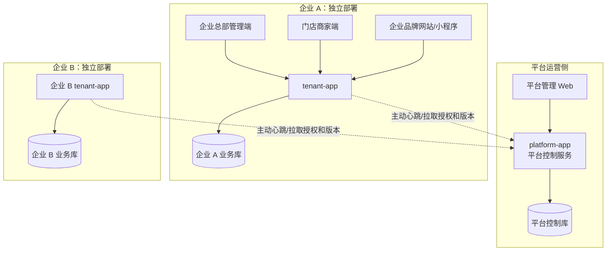

# 模块化多企业养老 SaaS 平台设计

- 文档版本：1.1
- 日期：2026-10-29
- 状态：评审稿
- 适用范围：平台运营总端、企业租户端、企业总部端、门店端、企业品牌客户端
- 现有项目：`E:\yanglao`
- 技术基线：Java 17、Spring Boot 3、MyBatis-Plus、MySQL 8、React 18、微信原生小程序

## 1. 文档目的

本文档定义项目从单租户养老系统升级为模块化多企业 SaaS 产品后的总体结构、业务边界、数据边界、接口规则和团队协作方式。目标不是描述一个抽象概念，而是让开发人员能够据此回答以下问题：

1. 新功能应放在哪个模块。
2. 模块可以访问哪些数据，不能访问哪些数据。
3. 模块如何声明权限、菜单、接口和数据库迁移。
4. 平台如何授权模块，企业如何启用和分配模块。
5. 前端如何按授权生成菜单和路由。
6. 模块之间如何调用，哪些调用被禁止。
7. 企业断网、模块过期、支付回调异常时系统如何处理。
8. 多个小组成员如何并行开发而不互相破坏。

### 1.1 核心目标

- 平台只管理企业、授权、销售、版本和汇总，不保存企业业务数据。
- 每家企业独立部署、独立数据库、独立小程序 AppID、独立域名和独立支付账户。
- 企业总部管理多个门店，门店拥有独立客户关系和经营数据。
- 免费基础底座保证企业即使不购买付费模块也能正常经营。
- 付费模块按企业授权、按门店分配，前后端同时校验。
- 新模块以新增表、新增迁移文件和新增接口为主，不修改其他模块已有数据。
- 模块依赖必须显式声明并校验，不能依赖启动顺序。
- 企业长期断网时仍能运行免费底座和已授权模块。
- 多人协作时，每个模块有清晰的数据所有权和接口边界。

### 1.2 非目标

以下内容不属于本次一期设计范围：

- 集中保存所有企业的客户、老人、健康、订单和支付数据。
- 所有企业共用一个微信小程序 AppID。
- 所有企业共用一个品牌网站域名。
- 企业上传任意 Java 插件或脚本。
- 第一期拆分微服务。
- 会员储值和预付卡金融业务。
- 健康安全、家庭关怀两个二期模块的完整业务实现。
- 平台直接连接企业数据库进行运维或排障。

## 2. 术语与统一命名

| 名称 | 定义 |
| --- | --- |
| 平台运营总端 | 软件厂商自己使用的控制后台，下文简称“平台端” |
| 平台控制库 | 保存企业、授权、套餐、销售订单和平台审计的数据库 |
| 企业租户端 | 每个购买方独立部署的软件实例，简称“租户端” |
| 企业业务库 | 企业租户端的业务数据库 |
| 企业总部管理端 | 企业管理门店、员工、角色、财务和品牌的入口 |
| 门店商家端 | 门店管理本店服务、订单、员工和支付的入口 |
| 企业品牌客户端 | 企业自己的小程序和网站 |
| 企业总部 | 企业管理层，不是超级门店 |
| 门店 | 服务交付和经营主体，只能属于一个企业 |
| 模块 | 可独立授权、独立分配、独立升级的业务能力包 |
| 免费基础底座 | 所有企业默认拥有、不依赖付费授权的经营能力 |
| 授权 | 平台允许某企业使用某模块及门店名额的许可 |
| 门店分配 | 企业总部将已授权模块分配给具体门店 |
| 企业启用 | 企业购买模块后在模块管理中主动打开开关 |
| 收尾期 | 模块到期后允许处理已有业务的 3 天窗口 |
| 正式授权 | 通过付费或平台正式发放的授权，可用于模块依赖判断 |
| 试用授权 | 有时限的体验授权，不能作为其他模块的正式依赖 |

文档中的“平台”一律指软件厂商的运营总端，不指企业品牌客户端。

## 3. 总体架构

### 3.1 系统拓扑



平台不代理企业客户请求。企业小程序、网站和管理端直接访问自己的 `tenant-app`。

### 3.2 平台端职责

平台端只负责控制面：

- 平台账号、平台角色和平台权限。
- 企业创建、停用、恢复和注销。
- 企业激活码和企业部署实例。
- 模块目录、模块版本、模块依赖和权限点目录。
- 模块价格、套餐、试用规则和门店名额。
- 平台模块销售订单、支付、退款和补偿。
- 授权文件签发、续期、暂停和撤销。
- 升级包发布、签名、灰度版本和兼容范围。
- 企业心跳、版本和授权状态。
- 平台审计和平台自身财务。
- 违规品牌页面的强制下线指令。

平台端不提供以下能力：

- 查看企业客户、老人、健康档案和员工明细。
- 查看企业业务订单和支付流水。
- 代替企业执行退款。
- 使用平台令牌进入企业租户端。
- 直接连接企业数据库。
- 集中保存企业业务指标明细。

### 3.3 企业租户端职责

企业租户端负责业务面：

- 企业总部、门店、员工和账号。
- 企业自定义权限组、总部角色和门店角色。
- 客户关系、服务、价格、排班、预约、订单和支付。
- 企业品牌页、门店首页和审核发布。
- 已购买模块的启用、门店分配、停用和数据管理。
- 企业审计、报表、备份和恢复记录。
- 本地授权验证和平台心跳。
- 企业自己的微信小程序登录、AppID 和 AppSecret。

### 3.4 信任边界

1. 平台控制库和企业业务库之间不建立数据库连接。
2. 平台和企业之间只允许企业主动发起 HTTPS 出站请求。
3. 平台不能主动访问企业内网服务。
4. 平台令牌和企业员工令牌使用不同签名密钥、不同 JWT 受众和不同认证入口。
5. 企业客户令牌和员工令牌也相互隔离。
6. 任何跨边界数据都必须经过明确接口，并记录授权和审计。

### 3.5 部署模式

支持两种交付方式：

| 模式 | 服务器 | 数据库 | 升级 | 备份 | 平台访问 |
| --- | --- | --- | --- | --- | --- |
| 企业自部署 | 企业提供 | 企业提供 | 企业确认，平台提供签名包 | 企业负责 | 默认不访问 |
| 平台托管 | 平台提供 | 平台为企业单独创建数据库 | 平台按策略升级 | 平台负责 | 仅运维，不读取业务内容 |

无论哪种模式，一个企业必须使用独立业务数据库或独立数据库 Schema，不能与其他企业共用业务表。

## 4. 代码结构

### 4.1 总体原则

采用“同一代码仓库、多个可执行程序、模块化单体”的结构：

- 同一仓库保证版本统一和接口同步。
- 平台端与租户端分别打包，避免平台程序误加载企业业务接口。
- 租户端内部按模块拆 Maven 子模块。
- 模块编译进租户端程序，通过授权开关启用，不做运行时任意代码加载。
- 模块之间依赖 API 包，不依赖实现包。
- 前端按平台管理端、租户管理端、品牌网站和小程序拆分。

### 4.2 建议仓库结构

```text
yanglao/
├── backend/
│   ├── pom.xml
│   ├── apps/
│   │   ├── platform-app/
│   │   └── tenant-app/
│   ├── libs/
│   │   ├── care-common/
│   │   ├── care-security/
│   │   ├── care-core-api/
│   │   ├── care-business-api/
│   │   └── care-module-api/
│   ├── core/
│   │   ├── care-core/
│   │   └── care-business/
│   ├── modules/
│   │   ├── institution/
│   │   │   ├── institution-api/
│   │   │   └── institution-impl/
│   │   ├── community/
│   │   │   ├── community-api/
│   │   │   └── community-impl/
│   │   └── membership/
│   │       ├── membership-api/
│   │       └── membership-impl/
│   └── platform/
│       ├── platform-core/
│       └── platform-licensing/
├── admin-platform/
├── admin-tenant/
├── brand-site/
├── miniprogram/
├── scripts/
└── docs/
```

### 4.3 程序入口

| 程序 | 端口建议 | 数据库 | 说明 |
| --- | --- | --- | --- |
| `platform-app` | 8081 | 平台控制库 | 平台管理、授权、销售 |
| `tenant-app` | 8082 | 企业业务库 | 企业总部、门店和客户端接口 |
| `admin-platform` | 5173 | 无 | 平台管理前端 |
| `admin-tenant` | 5174 | 无 | 企业总部和门店前端 |
| `brand-site` | 未固定 | 无 | 企业品牌网站 |
| `miniprogram` | 无 | 无 | 企业自己的微信小程序 |

平台端和租户端不得合并为一个运行实例。共用代码通过 Maven 依赖复用，不通过共用一个进程复用。

### 4.4 包命名规则

```text
com.smartelder.common              通用响应、错误、工具
com.smartelder.security            认证和通用安全组件
com.smartelder.platform            平台端业务
com.smartelder.core.api             基础底座对外接口和 DTO
com.smartelder.core.internal        基础底座实现
com.smartelder.business.api         订单、支付等业务接口
com.smartelder.business.internal    业务底座实现
com.smartelder.module.institution   机构康养模块
com.smartelder.module.community     社区居家模块
com.smartelder.module.membership    会员运营模块
```

模块内部建议再分：

```text
controller       HTTP 接口
application      用例编排
domain           领域对象和状态机
infrastructure   Mapper、外部适配器
api              对其他模块公开的接口和 DTO
event            发布和订阅事件
```

### 4.5 依赖规则

1. `tenant-app` 依赖各模块实现。
2. 模块实现可以依赖 `care-core-api` 和 `care-business-api`。
3. 模块不得依赖 `care-core` 或 `care-business` 的内部实现包。
4. 模块之间需要调用时，只能依赖对方的 `-api` 包。
5. 禁止依赖其他模块的 Entity、Mapper 和数据库表。
6. `platform-app` 不得依赖企业业务模块实现。
7. `care-common` 只放真正通用的能力，不能变成业务代码堆放区。
8. 共享接口变更必须由接口负责人评审，并运行全部契约测试。

## 5. 模块体系

### 5.1 模块清单

#### 免费基础底座

| 能力 | 说明 |
| --- | --- |
| 企业与企业配置 | 企业基本信息、品牌配置、模块状态 |
| 门店 | 门店创建、停用、撤店、首页和经营配置 |
| 员工与账号 | 总部员工、门店员工、账号和安全策略 |
| 权限 | 权限点、权限组、角色和数据范围 |
| 客户 | 企业客户身份和门店客户关系 |
| 服务 | 服务项目、价格和门店上架 |
| 排班 | 员工可用时间和门店排班 |
| 预约 | 预约创建、确认、取消 |
| 订单 | 通用订单、工单和状态机 |
| 支付 | 门店支付配置、支付、退款和对账 |
| 品牌页 | 企业品牌首页和门店首页 |
| 消息 | 站内消息和渠道扩展点 |
| 报表 | 基础经营指标 |
| 审计 | 权限、数据和关键操作审计 |
| 模块管理 | 授权查看、启用、分配和过期数据入口 |

#### 一期付费模块

| 模块代码 | 名称 | 能力 |
| --- | --- | --- |
| `institution` | 机构康养 | 床位、入住、退住、护理等级、护理计划、交接班、巡房、用药提醒 |
| `community` | 社区居家 | 居家服务、派单、上门打卡、服务记录、质检、评价联动 |
| `membership` | 会员运营 | 会员等级、权益、积分、跨店核销 |

#### 二期付费模块

| 模块代码 | 名称 | 能力 |
| --- | --- | --- |
| `health` | 健康安全 | 健康档案扩展、体征设备、阈值告警、SOS、告警处置 |
| `family` | 家庭关怀 | 家属绑定、消息、服务记录查看、视频探望扩展 |

二期模块不进入一期对外销售，但一期架构必须预留其权限、授权和接口扩展位置。

### 5.2 模块清单文件

每个模块必须在自己的资源目录提供 `module-manifest.yaml`。示例：

```yaml
code: institution
name: 机构康养
version: 1.0.0
vendor: smartelder

appVersion:
  min: 2.0.0
  max: 2.x

dependencies:
  - code: core
    type: BASE
    required: true
    minVersion: 1.0.0
  - code: membership
    type: OPTIONAL
    required: false
    minVersion: 1.0.0

permissions:
  - code: institution.bed.view
    name: 查看床位
  - code: institution.bed.manage
    name: 管理床位
  - code: institution.admission.manage
    name: 管理入住退住
  - code: institution.careplan.manage
    name: 管理护理计划

menus:
  - code: institution
    name: 机构康养
    route: /institution
    icon: institution
    permission: institution.bed.view
    defaultOrder: 200

api:
  basePath: /api/tenant/v1/modules/institution
  clientBasePath: /api/client/v1/modules/institution

schema:
  prefix: ins_
  migrationLocations:
    - classpath:db/migration/institution

events:
  publishes:
    - institution.admission.created
    - institution.admission.discharged
  subscribes:
    - order.paid
```

规则：

- `code` 发布后不可修改。
- `version` 使用语义化版本。
- 权限点前缀必须等于模块代码。
- 表前缀由模块独占。
- 菜单顺序以平台控制库配置为准，模块中的 `defaultOrder` 只作为初始值。
- 模块不得在清单中声明未由平台审批的任意入口。
- 平台控制库保存经过审核后的模块元数据，租户端升级时校验清单哈希。

### 5.3 模块状态

平台授权状态：

```text
TRIAL
ACTIVE
SUSPENDED
EXPIRED
REVOKED
```

企业模块状态：

```text
NOT_ENTITLED
DISABLED
ENABLED
WIND_DOWN
READ_ONLY
```

门店分配状态：

```text
UNASSIGNED
ASSIGNED
REVOKED
```

有效模块判定：

```text
平台授权有效
AND 企业已启用
AND 模块已分配到门店
AND 门店已启用
AND 当前不在授权暂停状态
= 门店模块可用
```

模块到期后：

- 到期时间至到期后 3 天为 `WIND_DOWN`。
- 收尾期只允许完成、取消或关闭已有业务，不允许新建业务。
- 收尾期结束后进入 `READ_ONLY`。
- `READ_ONLY` 允许查询和导出，不允许写入。
- 模块数据不因到期自动删除。

### 5.4 模块依赖

依赖类型：

| 类型 | 含义 | 是否要求正式授权 |
| --- | --- | --- |
| `BASE` | 依赖免费基础底座 | 免费底座始终可用 |
| `REQUIRED` | 必须依赖另一个付费模块 | 是 |
| `OPTIONAL` | 安装后可以使用对方能力 | 对方启用时才调用 |

规则：

1. 模块启用的构建顺序可以按依赖安排，但运行时依赖必须由清单声明。
2. 试用授权不能作为 `REQUIRED` 依赖。
3. 依赖模块被停用或过期时，依赖方不能新启用。
4. 依赖模块在收尾期内时，依赖方同时进入收尾期。
5. 依赖模块进入只读时，依赖方同时只读。
6. 删除被其他模块引用的模块数据时必须拒绝。
7. 模块调用依赖模块时，只依赖 `-api` 包，不读取对方表。

### 5.5 模块接口守卫

每个模块接口必须通过五道校验：

```text
登录身份校验
→ 角色权限校验
→ 门店数据范围校验
→ 模块授权和门店分配校验
→ 业务对象归属校验
```

建议使用：

```java
@RequirePermission("institution.bed.view")
@RequireStoreModule("institution")
@GetMapping("/beds")
public ApiResponse<List<BedView>> listBeds(@RequestParam String storeId) {
    return ApiResponse.ok(bedQueryService.list(storeId));
}
```

守卫实现要求：

- `@RequirePermission` 只判断功能权限。
- `@RequireStoreModule` 判断模块授权、企业启用、门店分配和门店状态。
- 数据范围由 `TenantAccessContext` 在服务层执行。
- 手工请求、内部调用和异步任务都必须经过相应校验。
- 菜单隐藏不能代替接口校验。

## 6. 数据架构

### 6.1 数据库划分

```text
平台控制库：只保存控制面数据
企业业务库：一个企业一个库或独立 Schema
```

平台与企业之间不共享数据库账号。企业之间也不共享业务表。

### 6.2 标识规范

- 数据库内部主键使用 `BIGINT`。
- 对外 API、URL、事件使用稳定的 `public_id`，建议使用 26 位 ULID。
- 企业编号使用平台签发的 `org_no`。
- 门店编号使用 `store_no`。
- 订单号使用业务可读编号，不能替代内部主键。
- 所有时间在数据库中统一使用 UTC 存储；对外接口统一使用带时区的 ISO 8601 字符串。
- 金额使用 `DECIMAL(12,2)`，对外 JSON 使用字符串，避免浮点误差。

### 6.3 表前缀

| 前缀 | 所属 |
| --- | --- |
| `pf_` | 平台控制库 |
| `iam_` | 企业身份、员工、角色和权限 |
| `core_` | 企业、门店、客户等基础实体 |
| `biz_` | 服务、价格、排班、预约 |
| `ord_` | 订单、工单和状态流水 |
| `pay_` | 支付配置、交易、退款和对账 |
| `site_` | 品牌页和门店页 |
| `msg_` | 消息通知 |
| `audit_` | 审计 |
| `sys_` | 幂等、事件、迁移和任务 |
| `ins_` | 机构康养模块 |
| `com_` | 社区居家模块 |
| `mem_` | 会员运营模块 |
| `hea_` | 健康安全模块，二期 |
| `fam_` | 家庭关怀模块，二期 |

### 6.4 平台控制库核心表

| 表 | 用途 |
| --- | --- |
| `pf_admin_user` | 平台管理员 |
| `pf_admin_role` | 平台角色 |
| `pf_admin_permission` | 平台权限点 |
| `pf_admin_role_permission` | 平台角色权限 |
| `pf_enterprise` | 企业主体和状态 |
| `pf_activation_code` | 一次性激活码 |
| `pf_deployment_instance` | 企业部署实例和设备指纹 |
| `pf_instance_public_key` | 企业实例心跳验签公钥 |
| `pf_module_definition` | 模块目录和菜单顺序 |
| `pf_module_dependency` | 模块依赖 |
| `pf_module_version` | 模块版本、兼容范围和签名 |
| `pf_module_price` | 模块价格 |
| `pf_plan` | 套餐 |
| `pf_plan_module` | 套餐包含模块和抵扣规则 |
| `pf_subscription_order` | 平台模块销售订单 |
| `pf_subscription_order_item` | 订单模块快照 |
| `pf_payment_transaction` | 平台销售支付流水 |
| `pf_refund` | 平台销售退款 |
| `pf_entitlement` | 企业模块授权 |
| `pf_license` | 授权文件版本和签名 |
| `pf_heartbeat` | 实例心跳和聚合状态 |
| `pf_support_grant` | 技术支持授权记录 |
| `pf_outbox_event` | 可靠事件 |
| `pf_idempotency_record` | 幂等记录 |
| `pf_audit_log` | 平台审计 |

### 6.5 企业业务库核心表

#### 身份与权限

| 表 | 用途 |
| --- | --- |
| `iam_staff` | 总部和门店员工账号 |
| `iam_customer_account` | 企业自己的客户登录身份 |
| `iam_role` | 总部角色和门店角色 |
| `iam_permission_group` | 企业自定义权限组 |
| `iam_permission_group_item` | 权限组包含的权限点 |
| `iam_role_permission_group` | 角色绑定权限组 |
| `iam_role_permission` | 角色单独允许或禁止的权限 |
| `iam_staff_role` | 员工角色 |
| `iam_staff_store_scope` | 总部员工负责的门店范围 |
| `iam_store_group` | 企业自定义门店分组 |
| `iam_store_group_member` | 门店分组成员 |
| `iam_refresh_token` | 刷新令牌和设备会话 |

#### 基础业务

| 表 | 用途 |
| --- | --- |
| `core_enterprise_config` | 当前企业配置 |
| `core_store` | 门店 |
| `core_store_config` | 门店经营配置 |
| `core_customer` | 企业客户资料 |
| `core_customer_store_relation` | 客户与门店关系 |
| `core_customer_consent` | 客户授权和隐私同意 |
| `biz_service` | 服务项目 |
| `biz_service_price` | 门店服务价格 |
| `biz_staff_schedule` | 员工排班 |
| `biz_appointment` | 预约 |
| `ord_order` | 业务订单 |
| `ord_order_item` | 订单明细 |
| `ord_work_order` | 派单和履约工单 |
| `ord_status_history` | 订单状态流水 |
| `pay_merchant_config` | 门店支付配置 |
| `pay_transaction` | 支付流水 |
| `pay_refund` | 退款流水 |
| `pay_reconciliation` | 对账记录 |
| `site_brand_page` | 企业品牌首页 |
| `site_brand_page_version` | 品牌页版本 |
| `site_store_page` | 门店首页 |
| `site_page_review` | 门店页审核 |
| `msg_notification` | 消息 |
| `audit_operation_log` | 企业业务审计 |
| `sys_outbox_event` | 企业可靠事件 |
| `sys_idempotency_record` | 企业幂等记录 |
| `sys_module_migration` | 模块迁移执行记录 |
| `sys_module_state` | 企业模块启用状态 |
| `sys_module_store_assignment` | 模块门店分配 |
| `sys_license_cache` | 本地授权文件缓存 |
| `sys_license_clock` | 最近可信平台时间和单调计数 |
| `sys_data_delete_request` | 过期模块数据删除申请 |

### 6.6 模块数据表

每个模块只拥有自己的表。示例：

```text
institution:
  ins_bed
  ins_admission
  ins_care_level
  ins_care_plan
  ins_care_task
  ins_shift_handover
  ins_round_record
  ins_medication_reminder

community:
  com_service_task
  com_visit_checkin
  com_service_record
  com_quality_check

membership:
  mem_level
  mem_account
  mem_benefit
  mem_entitlement
  mem_points_ledger
  mem_consumption_record
```

模块表通过 `store_id`、`customer_id`、`order_id` 等稳定字段引用基础对象，但不得对基础模块表写 SQL 连接查询。

### 6.7 数据库迁移规则

1. 生产环境不使用 `spring.sql.init` 自动建表。
2. 使用 Flyway 或同等版本化迁移工具。
3. 每个模块使用自己的迁移目录和迁移历史表。
4. 迁移文件只允许追加，不修改已经发布的文件。
5. 同一个模块内版本号必须递增。
6. 删除字段采用两阶段迁移：先停止使用，再在下个版本删除。
7. 每个迁移必须具备升级前备份和失败恢复说明。
8. 迁移由 `ModuleMigrationCoordinator` 按模块依赖顺序执行。
9. 应用启动时先检查所有待执行迁移的兼容性，再进入服务状态。
10. 禁止模块直接执行 `DROP TABLE` 删除其他模块数据。

建议迁移目录：

```text
resources/db/migration/core/V1__baseline.sql
resources/db/migration/institution/V1__institution_baseline.sql
resources/db/migration/community/V1__community_baseline.sql
resources/db/migration/membership/V1__membership_baseline.sql
```

### 6.8 数据留存与删除

- 模块过期不自动删除数据。
- 企业可配置永久保留或保留期限。
- 删除由门店管理员提出，企业总部审批。
- 审批通过后等待 24 小时执行。
- 等待期内门店和企业总部均可撤销。
- 模块在等待期内重新启用时，删除申请自动失效。
- 删除前提示并支持导出，但导出不是强制前置条件。
- 删除任务必须幂等、可审计、可重试。
- 删除只清理该模块在该门店范围内的数据，不删除基础客户和订单主数据。
- 被其他模块依赖的数据不得删除。
- 审计摘要保留，但不保留被删除的业务内容。
- 数据库备份中的副本按备份保留策略自然过期，删除接口不承诺即时清除历史备份。

## 7. 身份认证与权限

### 7.1 三类身份

```text
平台账号
企业员工账号
企业客户账号
```

三者使用不同的登录入口、令牌受众和令牌签名密钥。

| 身份 | 登录入口 | 数据归属 |
| --- | --- | --- |
| 平台账号 | `platform-app` | 平台控制库 |
| 企业员工 | 企业租户端 | 企业业务库 |
| 企业客户 | 企业小程序/企业网站 | 企业业务库 |

平台账号不能换成企业员工令牌。企业员工令牌不能调用平台接口。企业客户令牌不能调用管理端接口。

### 7.2 平台认证

- 平台管理员由平台团队创建。
- 平台支持 MFA；一期至少支持管理员重置密码和会话失效。
- 平台角色只能由平台超级管理员维护。
- 平台登录失败次数、锁定时间和会话有效期可配置。

### 7.3 企业首次开通

```text
平台创建企业
→ 平台生成一次性激活码
→ 企业在自己的服务器安装 tenant-app
→ 安装向导验证激活码
→ 企业平台生成实例指纹和实例密钥对
→ 平台登记实例并签发授权文件
→ 企业现场创建企业总部总管理员
→ 企业配置自己的域名、小程序和支付账户
```

平台不保存企业总部总管理员密码。遗忘密码时，由企业本地管理员重置；平台只能给企业注册联系人签发一次性恢复令牌。

### 7.4 企业员工登录

- 企业总部总管理员创建门店管理员。
- 门店管理员创建本店员工。
- 企业总部可以创建总部员工。
- 员工账号绑定企业、岗位和门店范围。
- 员工登录后由租户端签发员工令牌。
- 员工令牌不包含客户敏感信息。
- 访问每个业务对象时仍检查门店范围和对象归属。

### 7.5 企业客户登录

企业小程序 `AppID` 和 `AppSecret` 由企业租户端配置。登录链路：

```text
企业小程序 wx.login
→ 企业租户端 /api/client/v1/auth/wechat/login
→ 企业租户端调用微信接口换取 openid
→ 企业租户端创建或匹配企业客户身份
→ 企业租户端签发客户令牌
```

总平台不参与该链路，不接触 `openid`，不保存企业客户身份。

### 7.6 权限域

```text
平台权限域
  平台管理员、平台角色、平台权限点

企业权限域
  企业总部、门店、员工、企业角色、企业权限组
```

规则：

- 平台只定义可用权限点，不替企业分配员工权限。
- 企业管理自己的权限组、角色和员工分配。
- 企业不能获得平台端权限。
- 平台不能通过企业用户表获得平台权限。
- 平台技术支持不能使用平台令牌直接进入企业，必须由企业创建限时技术支持授权。

### 7.7 角色与权限组

企业角色分为：

- `HQ`：总部角色，可配置跨门店数据范围。
- `STORE`：门店角色，只能绑定本店员工。

权限计算：

```text
权限组允许集合
+ 角色单独允许集合
- 角色单独禁止集合
= 角色权限集合
```

最终有效权限：

```text
角色权限集合
∩ 员工数据范围
∩ 当前模块授权
∩ 门店状态
∩ 业务对象归属
= 实际允许操作
```

权限组是复用的权限集合，用户不能直接把权限授予某个员工而绕过角色。特殊权限通过创建专门角色或角色单独权限配置。

### 7.8 数据范围

总部员工支持：

- `ALL`：企业全部门店。
- `STORE_GROUP`：企业自定义门店分组。
- `STORES`：指定门店集合。
- `SELF`：本人负责或本人创建的数据。

门店员工固定为本门店。

数据范围在服务层解析，不能信任前端传入的 `orgId` 或 `storeId`。`TenantAccessContext` 由登录令牌和数据库配置生成，任何查询都必须用它裁剪。

### 7.9 权限点注册

权限点由模块清单注册到企业租户端，企业只能使用已注册权限点。代码示例：

```java
public enum CorePermission {
    STORE_VIEW("core.store.view"),
    STORE_MANAGE("core.store.manage"),
    CUSTOMER_VIEW("core.customer.view"),
    ORDER_VIEW("biz.order.view"),
    ORDER_REFUND("biz.order.refund"),
    FINANCE_EXPORT("pay.finance.export");

    private final String code;
}
```

模块权限必须使用模块前缀，例如 `membership.points.adjust`、`institution.careplan.manage`。

### 7.10 技术支持授权

平台不能默认查看企业业务数据。企业需要平台协助时：

1. 企业总部创建 1 至 72 小时的技术支持授权。
2. 授权包含原因、数据范围、允许的操作和到期时间。
3. 租户端签发仅能访问指定范围的临时员工身份。
4. 平台技术人员只能登录该企业租户端使用被授予的功能。
5. 所有查看、导出和修改操作写入企业审计。
6. 到期后自动失效，企业可提前撤销。

平台控制库只保存授权申请摘要和状态，不保存企业业务数据。
## 8. 授权、实例绑定与离线运行

### 8.1 设计原则

平台授权采用“平台签发、租户本地验证、联网复核”的控制方式。平台负责签发授权，企业租户端负责在本地验证授权和控制功能，不把每一次业务请求都转发给平台。

必须遵守以下原则：

1. 平台控制库不参与企业日常业务请求。
2. 平台不可用时，已下载且验证通过的授权仍然有效。
3. 网络恢复后，租户端必须主动向平台复核授权。
4. 授权文件必须带数字签名，租户端不能通过改数据库字段自行增加模块。
5. 授权必须绑定到具体部署实例，复制数据库到另一实例后不能直接复用。
6. 企业授权与门店分配是两个不同层次，平台只控制企业授权和门店名额，企业总部决定具体分配给哪些门店。
7. 离线宽限期不是永久离线授权。超过宽限期后，免费底座继续运行，付费模块进入只读状态。
8. 客户端、管理端和后端使用同一套模块判定结果，不能各自维护一套开关。

### 8.2 实例身份

企业首次安装 `tenant-app` 时生成以下信息：

```text
deployment_instance_id  平台登记后返回的实例编号
installation_id         本地随机生成的安装编号
tenant_database_id      写入企业数据库的随机 UUID
instance_key_pair       Ed25519 密钥对
instance_public_key    公钥，提交给平台
instance_fingerprint   实例指纹，由稳定字段计算
```

实例指纹计算输入：

```text
org_no
+ installation_id
+ tenant_database_id
+ instance_public_key_thumbprint
+ license_schema_version
```

不把 MAC 地址、主机名、磁盘序列号作为唯一指纹，因为服务器迁移、网卡更换和虚拟机快照会造成大量误锁。实例迁移必须通过平台“迁移实例”流程重新绑定，不能在租户端自行修改数据库绕过。

实例私钥只保存在租户服务器本地，建议放在环境变量或受限权限的密钥文件中，不能写入代码仓库、普通数据库明文列或前端。平台只保存公钥和摘要。

### 8.3 授权文件结构

授权文件使用 JSON，按规范化 JSON 序列化后签名。示例：

```json
{
  "schemaVersion": 1,
  "licenseId": "lic_01J...",
  "orgNo": "ORG-2026-0001",
  "deploymentInstanceId": "inst_01J...",
  "instanceFingerprint": "sha256:...",
  "issuedAt": "2026-10-29T10:00:00+08:00",
  "notBefore": "2026-10-29T10:00:00+08:00",
  "expiresAt": "2027-10-29T23:59:59+08:00",
  "offlineGraceDays": 7,
  "heartbeat": {
    "intervalHours": 6,
    "jitterMinutes": 30
  },
  "modules": [
    {
      "code": "institution",
      "licenseType": "FORMAL",
      "status": "ACTIVE",
      "startsAt": "2026-10-29T10:00:00+08:00",
      "expiresAt": "2027-10-29T23:59:59+08:00",
      "perpetual": false,
      "storeQuota": 20
    }
  ],
  "signature": {
    "algorithm": "Ed25519",
    "keyId": "license-key-2026-01",
    "value": "base64..."
  }
}
```

授权文件规则：

- `licenseType` 为 `TRIAL`、`FORMAL` 或 `PLATFORM_GRANT`。
- `perpetual=true` 时不设置该模块的到期时间，但实例仍须遵守心跳、暂停和撤销规则。
- 只有永久模块的授权文件可以不设置顶层 `expiresAt`；如果设置了顶层有效期，平台必须在到期前续签，不能让永久模块因文件本身过期而失去合法授权。
- `storeQuota` 按模块分别计算，不能把一个模块的名额挪给另一个模块。
- 授权签名覆盖除 `signature.value` 外的所有字段。
- 租户端只信任内置公钥列表中由 `keyId` 指定的公钥。
- 私钥由平台离线签发服务或受控 KMS 保管，不能出现在 Web 管理端代码中。
- 授权文件可以包含多个版本，但同一时刻只能有一个当前生效版本。
- 签名使用 Ed25519 或更强的非对称算法；算法和密钥轮换信息必须可升级。

### 8.4 首次激活

```text
平台创建企业并生成一次性激活码
→ 企业安装 tenant-app
→ 租户端生成实例密钥对和指纹
→ 安装向导携带激活码、指纹和公钥请求平台
→ 平台校验激活码未过期且未使用
→ 平台登记实例并签发初始授权
→ 租户端验签、落库并生成企业总部总管理员
→ 激活码立即失效
```

激活码只负责首次建立信任，不承担后续长期认证。激活码必须一次性使用、限时有效、限制尝试次数，并在成功激活后记录企业、实例和操作人。

### 8.5 本地授权验证

租户端每次启动和每次模块接口调用前，使用本地授权快照进行判定。判定顺序如下：

```text
授权签名有效
AND 实例指纹匹配
AND orgNo 匹配
AND notBefore <= 可信当前时间
AND 未超过本地可信到期时间
AND 模块状态允许
AND 企业已启用该模块
AND 门店已分配该模块
AND 门店状态允许
= 模块接口可访问
```

实现要求：

- 启动时完整验签，运行期间缓存验签结果。
- 授权文件变化、平台时间变化或超过缓存有效期后重新验签。
- 不把前端传来的模块开关、价格、到期时间当作授权依据。
- 每次写操作都重新检查模块是否允许写；读接口可以按 `READ_ONLY` 规则放行。
- 授权检查失败返回稳定的 `MODULE_NOT_AUTHORIZED`、`MODULE_DISABLED`、`MODULE_WIND_DOWN` 或 `MODULE_READ_ONLY` 错误码。
- 免费底座永远不依赖付费授权，但底座中的业务写操作仍受身份、权限、门店和业务状态约束。

### 8.6 平台心跳

租户端默认每 6 小时主动向平台发送心跳，并在启动、网络恢复、授权即将到期、手工刷新授权时额外发送。心跳加入随机抖动，避免所有企业同一时刻访问平台。

心跳请求只包含控制面信息：

```json
{
  "orgNo": "ORG-2026-0001",
  "deploymentInstanceId": "inst_01J...",
  "instanceFingerprint": "sha256:...",
  "appVersion": "2.1.0",
  "moduleVersions": {
    "institution": "1.2.0",
    "membership": "1.0.0"
  },
  "localLicenseId": "lic_01J...",
  "requestedAt": "2026-10-29T10:05:00+08:00",
  "nonce": "随机数",
  "signature": "使用实例私钥签名"
}
```

心跳请求禁止包含客户姓名、手机号、老人档案、订单明细、支付明细和健康数据。平台返回：

- 企业状态和实例状态。
- 当前应使用的授权文件或授权版本号。
- 平台建议的最低版本和升级包信息。
- 下次心跳时间。
- 平台公告、授权暂停或撤销指令。

心跳失败处理：

| 情况 | 租户端行为 |
| --- | --- |
| 网络超时、平台 5xx | 继续使用有效本地授权，记录告警并重试 |
| 平台返回 4xx 业务错误 | 记录原因，不删除业务数据 |
| 授权文件验签失败 | 保留旧授权，进入安全告警，不自动扩大权限 |
| 明确撤销或暂停 | 下一次业务判定时停止对应模块，已存在业务进入只读或收尾流程 |
| 实例不匹配 | 付费模块停止，免费底座可运行，要求企业重新绑定实例 |

平台不能因为心跳超时就主动删除企业数据库或清空企业授权。租户端也不能因为一次网络失败就立即停用所有付费模块。

### 8.7 离线宽限期

默认规则：

```text
0 至 7 天未联网：
  免费底座正常运行
  已授权且未到期的付费模块正常运行

超过 7 天未联网：
  免费底座正常运行
  付费模块只读，可查询和导出
  已有业务不得新建、修改或继续推进

重新联网并校验成功后：
  恢复所有有效授权模块的正常运行
```

宽限期天数由平台按企业配置，但必须写入授权文件，不能由租户端自行修改。平台可以为特殊企业签发长期离线授权，但长期授权仍需标注有效期、实例和签名。

离线期间的客户端和管理端必须显示明确的“离线宽限状态”，不能显示为正常在线。收银、下单等关键操作在只读状态下必须阻止，并提示联系企业管理员。

### 8.8 时间回拨和时钟异常

只依赖服务器本地时间容易被改时钟绕过授权，因此租户端维护：

- 最近一次可信平台时间。
- 最近一次可信平台时间的单调递增计数。
- 本地时钟相对平台时间的允许偏差。
- 首次启动时间和最近一次心跳时间。

如果检测到本地时间回拨超过配置阈值：

1. 允许免费底座继续使用。
2. 付费模块进入只读或临时锁定。
3. 记录安全审计。
4. 网络恢复后请求平台时间并重新验证授权。
5. 不允许用户通过修改系统时间恢复已过期模块。

NTP 可用时优先使用可信时间源，但 NTP 结果仍不能替代平台授权校验。

### 8.9 授权变更和补偿

授权变更必须形成可追踪事件：

```text
平台销售订单支付成功
→ 生成或更新 entitlement
→ 生成新授权文件
→ 写入平台 outbox
→ 企业心跳或主动刷新获取新授权
→ 租户端验签并切换授权
→ 租户端回报授权版本
→ 平台确认生效
```

如果支付成功但授权签发失败，平台必须进入自动补偿队列，不能只记录一条错误日志。补偿任务可以重试，超过阈值后转人工处理，并允许平台按规则发起退款。

如果授权已签发但企业未收到，企业可以在管理端点击“刷新授权”，平台根据订单和实例重新下发当前有效版本。刷新操作必须幂等，不能生成重复授权或重复计费。

### 8.10 升级包与授权升级

升级包规则：

- 升级包由平台签发并附带哈希、模块版本、最低底座版本和数据库迁移范围。
- 租户端先验证签名和哈希，再允许执行迁移。
- 数据库迁移前必须生成备份或快照。
- 升级失败时停止继续迁移，恢复应用旧版本；数据库已有破坏性变更时只能按迁移回滚脚本恢复，不能假装应用回滚即可。
- 模块升级不能绕过授权。升级包可以包含未购买的模块代码，但未授权模块的接口、菜单和数据表访问仍需守卫。
- 不允许从第三方来源安装未签名模块。
- 不允许企业修改授权验证的核心类、签名公钥和模块状态判断逻辑。

### 8.11 授权安全边界

需要明确：Java 应用和自部署软件无法做到绝对不可破解。本设计的目标是提高篡改成本、保证平台可撤销、保证合法企业离线可用，而不是承诺“永远不会被破解”。

防护层次：

1. 授权文件非对称签名。
2. 实例指纹和实例公钥绑定。
3. 关键模块接口后端校验。
4. 授权状态缓存与心跳复核。
5. 平台撤销和暂停能力。
6. 代码混淆、许可证声明和合同约束。
7. 日志发现异常实例和复制使用。
8. 关键版本可要求在线校验或硬件安全模块。

即使核心校验被修改，平台仍可通过版本升级、撤销授权、拒绝提供升级包和合同手段处理，但不能把商业安全完全建立在“前端隐藏菜单”上。

## 9. 模块商业化、套餐与销售订单

### 9.1 两类订单必须彻底分离

系统中存在两类完全不同的订单：

| 订单类型 | 买方 | 卖方 | 用途 | 数据位置 |
| --- | --- | --- | --- | --- |
| 平台模块销售订单 | 企业总部 | 软件厂商 | 购买模块、套餐、续费 | 平台控制库 |
| 企业门店业务订单 | 企业客户 | 具体门店 | 购买养老服务 | 企业业务库 |

平台模块销售订单不能出现在企业门店流水中，企业业务订单也不能用于平台模块授权。两者可以使用相似的支付适配器，但订单表、权限、退款流程和财务口径必须分开。

### 9.2 模块商品定义

模块商品至少包含以下字段：

```text
moduleCode         模块代码
name               销售名称
description        功能说明
versionRange       适用版本
billingMode        TRIAL / PERIOD / PERPETUAL
durationDays       周期授权的天数
price               标准价格
currency           币种
saleStatus          DRAFT / ON_SALE / OFF_SALE
storeQuota          平台给企业的可分配门店名额
quotaMode           FIXED / ENTERPRISE_SPECIFIC
trialDays           可选试用天数
trialEnabled        是否允许自助试用
```

模块价格和名额由平台配置，企业总部不能自行修改商品价格。企业总部只能在购买时选择平台提供的周期、套餐和数量。

### 9.3 试用规则

免费试用由企业总部在模块管理中自行领取，领取后立即生效：

- 每个企业、每个模块默认只能领取一次试用。
- 试用期限由平台配置，常见为 3、7 或 15 天。
- 试用授权不能作为其他模块 `REQUIRED` 依赖的正式授权。
- 试用期内可以使用对应模块功能，但必须显示试用标识和到期时间。
- 试用到期后进入收尾期，再进入只读。
- 平台可以撤销某企业的试用资格，但不能修改已经签发授权文件中的期限而不重新签发。
- 企业总部不能在门店端重复领取试用。

### 9.4 正式购买、续费和永久授权

购买周期的起算规则：

```text
模块未授权或已过期：
  生效时间 = 支付成功且授权生效时间
  到期时间 = 生效时间 + 购买周期

模块仍在有效期内：
  到期时间 = 原到期时间 + 购买周期
```

同一模块续费采用叠加，不从付款日重新覆盖剩余天数。例如原授权还剩 1 天，再购买 1 年，则新到期时间为原到期时间加 365 天，而不是从付款日重新计算 365 天。

永久授权的规则：

- 永久授权表示无需再购买使用期限，但仍需要有效实例、合法企业、模块启用和门店分配。
- 永久授权仍可因企业停用、授权撤销、安全事件或实例不匹配而被暂停。
- 已购买永久授权的模块再次购买只产生价格抵扣，不重复叠加永久授权。
- 永久授权模块的数据保留和删除仍受企业配置和隐私规则约束。

### 9.5 套餐和套装包

套餐只是把多个模块组合成一个购买入口，不创建一个新的“超级模块”。购买套餐后，系统必须拆成各模块独立的授权记录。

套餐示例：

```text
养老基础套装
  机构康养 1 年
  会员运营 1 年
  套餐优惠价格 1,800 元
```

套餐展示和购买规则：

1. 套餐内包含的模块及版本、周期、门店名额必须写入订单快照。
2. 购买前必须校验套餐内所有 `REQUIRED` 依赖都能形成正式授权闭环。
3. 套餐中某模块已有有效正式授权时，按该模块标准价格抵扣。
4. 套餐中某模块已有永久授权时，也按标准价格抵扣。
5. 套餐中已有授权模块不额外延长有效期；套餐购买只补齐尚不拥有的模块。升级或续费已有模块必须走单独的续费入口。
6. 如果套餐内所有模块都已经是永久授权，则该套餐对企业总部隐藏，不允许购买。
7. 如果套餐内至少还有一个模块不是永久授权，则套餐仍显示，并按规则计算抵扣。
8. 套餐价格不能低于平台配置的最低成交价；特殊折扣必须由平台审批。
9. 套餐抵扣总额不得超过套餐成交价；应付金额 = 套餐价 - 抵扣总额，且不得低于平台配置的最低成交价。
10. 套餐购买成功后，订单必须记录每个模块的抵扣、实际成交价和授权结果，不能只记录一个套餐总价。

举例：

```text
套餐包含 A、B，标准价分别为 500、700，套餐价 1000。

企业已有 A 的 1 年正式授权：
  套餐仍显示。
  应付 = 1000 - 500 = 500。
  购买后只新增 B 的 1 年授权，A 不延长。

企业已有 A 的永久授权：
  套餐仍显示，因为 B 尚未永久拥有。
  应付 = 1000 - 500 = 500。
  购买后只新增 B 的 1 年授权。

企业已有 A、B 两个永久授权：
  套餐隐藏。
```

套餐不允许出现“先买 A、C 才发现 C 不是所需模块”的问题。平台可以在购买页显示套餐包含模块、依赖关系、已拥有模块和抵扣结果，并在支付前让企业确认。

### 9.6 门店名额

门店名额按模块分别计算，不能跨模块借用：

```text
企业 A：
  机构康养：20 个门店名额
  社区居家：5 个门店名额
  会员运营：10 个门店名额
```

规则：

- 平台可给不同企业设置不同名额。
- 名额由企业总部在模块管理中分配给门店。
- 一个门店在一个模块上只能有一条有效分配记录。
- 分配后即占用名额，即使门店之后被停用或撤店，也不自动释放。
- 只有企业总部手动撤销分配后，才释放名额。
- 门店管理员不能给自己增加名额，也不能把名额分配给自己。
- 门店重新启用时可以恢复原分配，但前提是分配记录仍为有效且名额未被撤销。
- 平台调整企业名额时必须生成授权新版本，并记录变更原因和操作人。
- 一期不单独售卖门店名额，只由平台按企业配置上限；后续如果需要售卖，新增独立的名额商品和订单类型。

### 9.7 模块依赖购买校验

购买任何模块前，平台和租户端都必须检查依赖：

```text
目标模块没有 REQUIRED 依赖
OR 每个 REQUIRED 依赖都有有效正式授权且未过期
```

补充规则：

- 试用不能作为 `REQUIRED` 依赖。
- 依赖模块被暂停时，依赖方不能新启用。
- 依赖模块进入收尾期时，依赖方同时进入收尾期。
- 依赖模块进入只读时，依赖方同时只读。
- 依赖关系必须来自平台审核后的模块版本元数据，不能只由前端页面判断。
- 如果依赖模块已经过期，购买页应明确提示先购买或续费依赖模块。

### 9.8 平台销售支付流程

```text
企业总部选择模块或套餐
→ 平台计算价格、抵扣、周期和依赖
→ 生成销售订单快照
→ 企业总部支付
→ 支付回调验签
→ 订单置为 PAID
→ 生成 entitlement 变更
→ 生成新授权文件
→ 通知租户端拉取
→ 租户端验签回报
→ 订单置为 FULFILLED
```

订单状态建议：

```text
DRAFT
PENDING_PAYMENT
PAID
FULFILLING
FULFILLED
PAYMENT_FAILED
REFUND_PENDING
REFUNDED
CANCELLED
MANUAL_REVIEW
```

必须使用幂等键和支付回调去重。支付回调只能改变支付事实，不能直接在前端请求中“成功即开通”。授权开通是一个可补偿的业务步骤。

### 9.9 支付异常和退款

支付成功但授权失败时：

1. 订单进入 `FULFILLING` 或 `MANUAL_REVIEW`。
2. 自动补偿任务重试授权签发。
3. 超过重试阈值后通知平台运营人员。
4. 授权尚未生效时，可以按平台规则自动退款。
5. 授权已经生效后，退款必须人工审批。
6. 退款成功后必须撤销对应模块授权，并生成新的授权文件。
7. 已产生的模块数据不能被立即删除，只能进入只读或按企业数据删除流程处理。

一期建议不支持套餐部分退款。一个套餐订单要么整体退款并撤销该订单带来的授权，要么由平台人工处理特殊情况。这样可以避免套餐中模块抵扣、剩余周期和已使用数据之间出现无法解释的状态。

### 9.10 授权到期和收尾期

模块到期后：

```text
到期时刻
→ 3 天 WIND_DOWN 收尾期
→ READ_ONLY 只读期
→ 企业决定保留、续费或申请删除数据
```

收尾期允许：

- 完成已有订单或服务。
- 关闭已有工单。
- 取消未开始的服务。
- 导出数据。
- 查看账单和授权记录。

收尾期不允许：

- 新建订单。
- 新建服务记录。
- 新建会员等级或权益。
- 新增需要模块授权的业务对象。

只读期允许查询和导出，不允许业务写入。企业续费并完成授权刷新后，模块从只读恢复为启用状态，原数据继续使用。

### 9.11 平台销售财务边界

平台模块销售款进入平台自己的收款账户，只用于模块、套餐、续费和后续平台明确售卖的服务。企业门店业务款进入各门店自己的收款账户，平台不代收、不分账、不清算企业业务资金。

平台控制库只保存模块销售订单和平台自己的退款记录，不保存企业门店业务支付流水。企业业务库只保存企业自己的支付和退款记录，不保存平台模块购买订单。

## 10. 企业组织结构与企业管理

### 10.1 企业租户

一个企业租户代表一个独立品牌和独立经营主体，包含：

```text
企业总部
├── 总部员工
├── 门店 A
│   ├── 门店管理员
│   └── 门店员工
├── 门店 B
└── 企业品牌客户端
```

企业总部不是“超级门店”。它不直接拥有另一家门店的客户关系，而是拥有跨门店的管理视角。总部员工可以看到哪些门店、哪些客户和哪些业务数据，由其角色权限和数据范围共同决定。

一个门店只能属于一个企业。跨企业连锁、加盟商或独立法人必须分别建立企业租户，不能在同一条门店记录中归属多个企业。

### 10.2 企业总部管理范围

企业总部负责：

- 企业基本资料和品牌配置。
- 创建、停用、恢复门店。
- 创建门店管理员账号。
- 创建总部员工、门店角色和企业权限组。
- 给员工分配角色和数据范围。
- 管理企业级服务目录和门店价格策略。
- 查看被授权范围内的订单、客户、财务和经营分析。
- 购买模块、分配模块名额、启用或停用模块。
- 审核门店首页和发布企业品牌首页。
- 管理企业级通知、公告和品牌资产。
- 提出过期模块数据删除申请并审批门店申请。
- 创建限时技术支持授权。

企业总部不能：

- 获得平台控制库权限。
- 修改平台模块价格、套餐规则和平台角色。
- 绕过模块授权直接访问未购买模块接口。
- 使用总部账号直接替代门店员工执行本店业务，除非其角色明确包含相应门店权限和业务权限。
- 自行修改其他企业的数据。

### 10.3 门店

门店是实际经营和服务交付主体，拥有独立的：

- 门店名称、地址、联系电话和营业时间。
- 门店首页、服务项目、价格和可预约时段。
- 门店客户关系。
- 门店员工和排班。
- 门店订单、工单、支付账户和退款记录。
- 门店经营数据和报表。
- 门店专属小程序码和分享卡片。

门店页面由门店编辑，企业总部审核后发布。门店价格可以由门店在总部允许的范围内配置，不能由客户端传入或前端自行计算。

### 10.4 门店生命周期

建议状态：

```text
DRAFT
ACTIVE
SUSPENDED
CLOSED
```

| 状态 | 允许新建业务 | 数据访问 | 模块名额 |
| --- | --- | --- | --- |
| `DRAFT` | 否 | 总部可配置 | 尚未分配时不计入有效门店 |
| `ACTIVE` | 是 | 按权限访问 | 分配后占用名额 |
| `SUSPENDED` | 否 | 只读，总部可管理 | 保留，直到总部手动撤销 |
| `CLOSED` | 否 | 总部可查询和导出 | 保留，直到总部手动撤销 |

门店停用或撤店由企业总部操作，不由门店员工自行决定。停用或撤店不会自动解除模块分配，这条规则保证门店恢复后可以继续使用原模块；释放名额必须由企业总部手动撤销。

### 10.5 总部端和门店端的关系

`admin-tenant` 可以提供两个工作台入口：

```text
企业总部工作台
门店工作台
```

两者使用同一套认证和权限底座，但加载不同菜单和数据范围：

- 总部员工登录后加载总部角色、被授权门店范围和跨店汇总功能。
- 门店员工登录后加载本店工作台，不需要选择门店。
- 总部员工进入某家门店时，必须仍受其角色权限和数据范围约束。
- 不能在门店端使用“传入任意 storeId”越过总部数据范围。
- 平台不向企业总部下发平台角色；平台只是提供已注册权限点。

### 10.6 企业角色、权限组和员工

平台负责定义权限点，包括：

- 权限点属于哪个模块。
- 权限点允许执行什么操作。
- 权限点属于平台域还是企业域。
- 权限点在哪个版本可用。

企业总部负责：

- 创建和修改企业权限组。
- 创建和修改总部角色、门店角色。
- 给角色选择权限组和单独允许/禁止的权限。
- 给员工分配角色、门店和生效时间。
- 停用员工、撤销角色和查看权限审计。

企业角色不能获得平台权限点。平台角色也不能直接绑定到企业员工。企业可以在未购买模块时预先配置模块角色，但该模块权限不在授权有效期内时不生效。

角色权限计算：

```text
权限组集合
+ 角色单独允许
- 角色单独禁止
= 角色权限集合
```

最终有效权限仍必须再经过数据范围、模块授权、门店状态和业务对象归属校验。

### 10.7 企业客户身份

企业客户身份属于企业，不属于平台。一个客户在该企业内可以只有一个客户主账号，但在不同门店拥有不同的客户关系。

```text
core_customer               企业客户主账号
core_customer_store_relation 客户与门店的业务关系
core_customer_consent       客户授权、隐私和营销同意
```

规则：

- 微信 `openid` 只在该企业的小程序 AppID 下有意义，不能跨企业识别同一个自然人。
- 客户主账号由企业租户端创建和保存，平台不保存 `openid`。
- 客户首次在门店下单时，建立或恢复该门店的客户关系。
- 客户在 A 店消费过，不自动让 B 店员工看到 A 店订单。
- 企业总部具备跨店数据范围时，可以查看其管理范围内的客户汇总。
- 会员模块可以在同一企业内跨店识别会员身份，但调用方仍必须遵守门店数据权限。
- 不存在跨企业的平台级客户账号。“一个客户账号”始终指某一个企业租户内的客户账号。
- 员工只能查看与其业务关系相关的客户资料，不能把企业总部客户总表当作员工可任意浏览的通讯录。

### 10.8 客户授权与跨店识别

客户登录企业小程序后，先加载企业品牌首页，再选择门店。客户可以：

- 匿名浏览品牌页和门店页。
- 在预约、下单、支付或查看订单时登录。
- 切换到已访问过的门店。
- 通过门店小程序码、分享卡片和最近访问入口直接进入门店。
- 查看自己在本企业内的订单、预约、会员权益和授权关系。

跨店会员识别必须基于客户主动登录和隐私授权。不能通过手机号自动拼接客户身份，也不能把平台级别身份当作企业客户身份。

### 10.9 品牌页和门店页

品牌资源包括：

- 企业 Logo、名称、简介、联系方式和服务承诺。
- 品牌首页版本、草稿、已发布版本和发布时间。
- 门店列表、门店卡片和门店快捷入口。
- 门店首页草稿、待审核版本、已发布版本和审核记录。
- 页面组件配置、主题色、图片和可见范围。

页面只允许使用平台提供的受控组件和模板，不允许上传任意 JavaScript、HTML 或远程脚本。这样可以避免白标页面变成跨租户 XSS 和供应链攻击入口。

### 10.10 品牌页发布规则

企业品牌首页：

```text
企业总部编辑
→ 企业总部直接发布
→ 平台可事后巡检
→ 违规时平台强制下线
```

门店首页：

```text
门店编辑草稿
→ 提交企业总部审核
→ 审核通过
→ 发布门店版本
→ 生成门店专属访问入口
```

审核不通过时必须填写原因。门店修改已发布页面时，线上旧版本继续可用，审核通过后再原子切换新版本，不能出现用户看到半成品页面的情况。

## 11. 企业核心业务底座

### 11.1 基础服务目录和门店价格

基础底座提供企业级服务目录：

```text
biz_service
  服务代码、名称、分类、说明、默认时长、服务主体

biz_service_price
  门店、服务、销售价格、成本价、生效区间、状态
```

规则：

- 企业总部可以创建服务模板。
- 门店可以在总部允许范围内配置本店价格。
- 客户端展示的价格必须来自服务端按门店计算的结果。
- 下单时必须保存服务名称、价格、时长、门店和优惠快照。
- 后续修改服务价格不能反向改变历史订单金额。
- 服务下架不影响历史订单查询。
- 不同门店的同类服务可以有不同价格和服务内容。

### 11.2 排班和预约

排班属于门店经营数据。员工只能查看自己权限范围内的排班：

```text
biz_staff_schedule
  门店、员工、开始时间、结束时间、可预约容量、状态
```

预约校验至少包括：

1. 门店处于 `ACTIVE`。
2. 服务在本店上架且有效。
3. 员工属于本店且具备服务资格。
4. 时间段可用且未超出容量。
5. 客户身份和联系方式有效。
6. 当前用户有权代表该客户创建预约。
7. 模块授权状态允许当前操作。

并发预约必须使用数据库条件更新、唯一约束或行锁防止超卖。不能只先查询再插入。

### 11.3 通用订单和模块订单

基础底座定义通用订单和状态机，具体模块不能自行创建一套无法统一的订单体系。模块可以扩展业务单据，但订单主体仍由 `care-business` 管理。

建议订单状态：

```text
CREATED
PENDING_PAYMENT
PAID
ACCEPTED
DISPATCHED
IN_SERVICE
COMPLETED
CANCELLED
REFUNDING
REFUNDED
CLOSED
```

允许流转：

```text
CREATED -> PENDING_PAYMENT
CREATED -> CANCELLED
PENDING_PAYMENT -> PAID
PENDING_PAYMENT -> CANCELLED
PAID -> ACCEPTED
PAID -> REFUNDING
ACCEPTED -> DISPATCHED
ACCEPTED -> REFUNDING
DISPATCHED -> IN_SERVICE
DISPATCHED -> CANCELLED
IN_SERVICE -> COMPLETED
IN_SERVICE -> REFUNDING
REFUNDING -> REFUNDED
REFUNDED -> CLOSED
COMPLETED -> CLOSED
CANCELLED -> CLOSED
```

实际状态不能只靠前端修改。每次流转必须：

- 在服务层校验来源状态和目标状态。
- 校验当前操作人或系统任务有权限。
- 写入 `ord_status_history`。
- 使用幂等键防止重复推进。
- 触发可靠事件，例如 `order.paid`、`order.completed`。

### 11.4 工单与履约

订单表示交易，工单表示履约任务。社区居家、机构护理和设备服务等都可以创建工单，但不能绕过订单和履约状态。

工单至少包含：

```text
workOrderId
orderId
storeId
serviceId
assigneeStaffId
status
scheduledAt
checkedInAt
completedAt
completionSummary
```

派单规则由业务模块或底座扩展点实现。默认建议：

1. 优先选择门店指定服务人员。
2. 其次选择同门店、具备服务资质且负载最低的员工。
3. 无可用人员时进入人工派单队列。
4. 禁用、离职或超出数据范围的员工不能被自动派单。
5. 派单算法必须输出可解释的选择原因。

### 11.5 支付适配器

支付底座只负责统一支付接口，不把微信、支付宝、银联的业务差异散落到订单模块。

统一接口示例：

```java
public interface PaymentGateway {
    PaymentCreateResult create(PaymentCreateCommand command);
    PaymentQueryResult query(String paymentNo);
    RefundResult refund(RefundCommand command);
    boolean verifyCallback(String provider, String payload, String signature);
}
```

每个门店配置自己的商户信息：

```text
pay_merchant_config
  storeId
  provider         WECHAT / ALIPAY / UNIONPAY
  merchantNo
  appId
  encryptedSecret
  certificateRef
  notifyUrl
  status
```

支付规则：

- 一期微信小程序只支持微信支付。
- 企业网站和 H5 页面支持微信、支付宝、银联，具体以企业实际开通的支付通道为准。
- 微信小程序不能直接拉起支付宝客户端。需要支付宝支付时，只能进入企业自己的外部浏览器或 H5 支付流程，并重新处理登录、回调和订单状态。
- 不允许平台统一代收企业门店业务款，除非未来另行设计合规的资金分账方案。
- 支付密钥必须加密存储，不能返回前端。
- 支付回调必须验签、去重、幂等，并以支付平台主动查询结果为准。
- 支付成功事件必须通过 outbox 发布，不能只在回调事务里直接修改订单后丢失通知。
- 退款必须有原支付流水、退款原因、审批人和退款状态。

### 11.6 退款和对账

退款流程：

```text
门店发起退款
→ 校验订单状态和退款权限
→ 企业总部或门店按权限审批
→ 调用支付渠道
→ 记录退款流水
→ 发布 refund.succeeded / refund.failed
→ 更新订单状态
```

对账至少支持：

- 按门店、渠道、日期汇总平台支付流水。
- 记录渠道账单下载和校验结果。
- 发现单边成功、金额不一致、重复回调时生成异常任务。
- 对账异常不能自动修改历史订单金额，必须进入人工复核。

平台模块销售退款走平台自己的退款流程，不能调用企业门店的退款接口。

### 11.7 会员运营模块

会员模块的企业级概念包括：

```text
会员等级
会员权益
积分账户
积分流水
权益核销记录
```

会员身份以企业客户主账号为基准，可以跨本企业门店使用。权益支持两个作用域：

- `ENTERPRISE`：企业内全部门店通用。
- `STORE`：仅指定门店可用。

门店员工核销会员权益时，只能看到完成本次核销所需的最小信息。系统可以验证该客户在其他门店获得的会员权益，但不能把其他门店的消费明细、员工记录或客户备注暴露给当前门店员工。

会员模块不得直接查询 `core_customer` 表。它通过 `CustomerQueryApi` 获取客户摘要，通过事件接收客户合并或停用通知。

### 11.8 积分和跨店业务边界

一期会员模块建议支持：

- 消费获得积分。
- 积分累计、扣减、过期和人工调整。
- 积分流水可追溯。
- 会员等级按平台或企业配置规则计算。
- 权益配置和核销。
- 跨店会员识别。

跨店积分结算、门店之间成本分摊和连锁财务清算属于后续独立设计，不在本期偷偷塞进会员表。若后续需要门店间结算，应新增结算模块和独立账本，不能修改历史积分流水语义。

### 11.9 机构康养模块

机构康养模块负责：

- 床位、楼栋、房间和床位状态。
- 入住、换床、请假、退住。
- 护理等级评估。
- 护理计划和护理任务。
- 交接班、巡房和用药提醒。
- 机构内部业务记录。

模块通过基础底座接口获取门店、员工、客户、订单和服务信息。床位、入住和护理数据只能由机构康养模块自己维护。机构模块不得直接修改基础客户表或订单表，只能调用基础业务 API。

### 11.10 社区居家模块

社区居家模块负责：

- 居家服务任务。
- 上门派单。
- 服务人员打卡。
- 服务过程记录。
- 质检和异常处理。
- 服务评价关联。

社区模块不得直接查询机构床位或护理计划，也不得直接修改订单主表。订单支付、取消和退款仍由基础订单与支付服务处理。社区模块通过事件获得订单状态变化，并在自己的任务表中记录履约状态。

### 11.11 健康安全和家庭关怀

二期模块复用同一套模块协议：

- `health` 负责体征、阈值、SOS 和告警处置数据。
- `family` 负责家属绑定、消息和授权范围内的服务记录查看。

一期只保留模块目录、依赖、权限点、事件契约和表前缀，不提前创建不可维护的空表。二期实现时新增自己的模块迁移和模块 API。

### 11.12 消息和通知

基础通知能力提供：

- 站内消息。
- 模板管理。
- 渠道适配器 `ChannelSender`。
- 重试、幂等和发送记录。
- 敏感字段脱敏。

一期渠道发送器可以是日志或模拟实现，但接口必须允许后续接入微信订阅消息、短信和邮件。业务模块只发布“事件和模板参数”，不直接调用具体短信厂商。

### 11.13 经营分析和报表

报表分为三层：

1. 基础经营指标：订单数、收入、退款、客流、服务完成率。
2. 门店指标：本店经营数据，仅门店权限可见。
3. 企业汇总指标：企业总部按数据范围查看多个门店。

一期允许通过基础查询或事件汇总生成报表，但禁止让报表模块直接 JOIN 所有模块私有表。跨模块报表必须消费公开事件或调用模块公开的统计 API。数据量大后再引入独立只读模型或数据仓库。

### 11.14 审计

所有关键动作必须写企业审计：

- 登录、登出和失败登录。
- 角色、权限组和数据范围变更。
- 员工创建、停用和门店调动。
- 门店停用、恢复和撤店。
- 付款、退款、价格修改和订单状态变更。
- 模块启用、停用、分配、撤销和数据删除。
- 技术支持授权的创建、使用和撤销。
- 数据导出和隐私信息查看。

审计记录至少包括操作人、企业、门店、对象类型、对象 ID、动作、结果、来源 IP、用户代理、请求 ID、前后摘要和时间。审计内容不能包含完整支付密钥、密码或不必要的健康隐私。
## 12. 企业品牌客户端

### 12.1 客户端边界

企业品牌客户端只连接本企业租户端：

```text
企业自己的微信小程序/网站
→ 企业自己的域名
→ 企业自己的 tenant-app
→ 企业自己的业务数据库
```

客户端不直接连接平台控制服务，不携带平台账号，不读取平台授权接口。模块授权由企业租户端根据本地授权决定哪些页面、服务和接口可用。

### 12.2 一个小程序，一个企业品牌

一个企业使用一个企业品牌小程序 AppID。门店不需要各自申请独立小程序 AppID。门店通过以下数据区分：

- 企业品牌首页。
- 门店选择。
- 门店专属页面。
- 门店专属服务、价格、员工和订单。
- 门店专属小程序码。
- 门店分享卡片。

小程序页面建议：

```text
pages/brand/home          企业品牌首页
pages/store/list          门店选择
pages/store/home          门店首页
pages/store/services      门店服务
pages/store/detail        服务详情
pages/order/confirm       确认订单
pages/order/list          我的订单
pages/order/detail        订单详情
pages/member/home         会员中心（模块启用时）
pages/profile/index       个人中心
```

### 12.3 进入链路

普通入口：

```text
打开企业小程序
→ 品牌首页
→ 简介、品牌信息、门店列表、最近访问
→ 选择门店
→ 门店首页
→ 加载该门店价格、服务、页面和活动
```

门店直达入口：

```text
扫描门店小程序码 / 点击门店分享卡片
→ 解析门店 public code
→ 校验门店属于当前企业且可访问
→ 直接进入门店首页
→ 同时写入最近访问记录
```

直达入口不能使用内部自增 ID 作为公开参数，应使用稳定的 `storePublicId` 或签名场景值。进入后必须重新从服务端加载门店状态、价格和模块状态，不能复用品牌首页缓存的旧价格。

### 12.4 门店快捷入口

微信小程序支持：

- 门店专属小程序码。
- 门店分享卡片。
- 品牌首页的门店卡片。
- 最近访问门店。
- 客户主动收藏的门店。
- 分享链接或场景值直接进入门店。

不要把“门店专属小程序码”理解为每个门店拥有独立 AppID。它只是一个带门店场景值的入口。微信客户端的“我的小程序”仍指向企业品牌小程序；门店直达依赖场景路径和首页承载逻辑。

### 12.5 品牌首页和门店首页数据

品牌首页只展示企业公开信息：

- 企业品牌、简介、Logo、联系方式和门店列表。
- 公开的门店地址和营业时间。
- 企业公告和公开活动。
- 已启用的公开模块入口。

门店首页展示：

- 门店名称、图片、地址和联系方式。
- 本店服务、价格、排班和评价。
- 本店公告和活动。
- 本店会员权益入口。
- 当前门店可用的模块功能。

品牌首页和门店首页不能返回未公开的员工信息、客户信息、内部健康数据或其他门店的营业数据。

### 12.6 客户端认证

匿名浏览不要求登录。以下操作要求客户登录：

- 创建预约。
- 创建订单。
- 支付。
- 查看订单和服务记录。
- 查看会员权益。
- 绑定家属或查看授权范围内的记录。

企业网站可以采用手机号验证码、微信网页授权或企业自己配置的登录方式。微信小程序使用企业自己的 AppID 完成 `wx.login`。平台不保存企业客户身份、`openid` 或支付账户。

### 12.7 下单和支付

客户端下单流程：

```text
选择门店
→ 选择服务
→ 选择时间/数量
→ 服务端重新计算价格和可用性
→ 创建订单
→ 获取支付参数
→ 小程序微信支付
→ 支付回调确认
→ 服务端通知订单已支付
→ 跳转订单详情
```

前端提交的服务名称、价格、优惠和门店名称只能作为展示信息，最终金额必须由服务端按当前门店配置重新计算。支付成功页不能凭前端结果直接标记订单已支付，必须等待服务端查询或回调确认。

网站支付流程可以按渠道跳转：

```text
企业网站订单
→ 服务端创建支付意图
→ 微信/支付宝/银联 H5 或二维码支付
→ 返回企业网站
→ 服务端查单并确认结果
```

微信小程序内一期只使用微信支付。若客户需要支付宝或银联，可进入企业自己的外部浏览器网站完成支付；跳转后必须重新校验客户登录状态和订单归属。

### 12.8 分享、二维码和页面版本

门店分享卡片必须携带：

```text
storePublicId
pageVersionId（可选，仅用于缓存失效）
shareScene
```

分享名称、封面和描述来自已发布门店页面。门店草稿、未审核页面和含敏感数据的页面不能生成对外分享卡片。

门店二维码在门店首页发布后生成。门店撤店、停用或页面被强制下线时，旧二维码仍可被扫描，但服务端必须返回明确的下线页面，不能继续展示过期价格或继续接单。

### 12.9 客户端模块展示

小程序前端根据服务端返回的公开模块能力加载页面和入口：

```json
{
  "storePublicId": "st_01J...",
  "storeName": "康颐护理 A 店",
  "enabledModules": ["institution", "membership"],
  "features": {
    "membership": {
      "pointsVisible": true,
      "benefitVisible": true
    }
  }
}
```

前端隐藏入口只改善体验，不构成安全边界。直接访问未授权页面时，后端仍必须返回未授权错误，前端显示统一的无权限或模块未开通页面。

### 12.10 隐私和未成年人

- 客户手机号、身份证、健康信息和联系人信息按最小必要采集。
- 家属查看老人信息必须经过老人或合法监护人授权。
- 未成年人、无民事行为能力人的数据处理按适用法律和监护关系校验。
- 营销授权与业务履约授权分开保存。
- 客户可以查询、更正、导出和申请删除其个人数据，具体范围受业务留存和法定义务限制。
- 日志、埋点和分享参数不得包含身份证号、健康详情和完整手机号。

## 13. 后端接口与模块调用规范

### 13.1 API 命名空间

所有外部 HTTP 接口必须使用稳定命名空间：

```text
/api/platform/v1/**       平台控制面
/api/tenant/v1/hq/**      企业总部管理端
/api/tenant/v1/store/**   门店管理端
/api/client/v1/**         企业客户
/api/public/v1/**         企业公开品牌和门店页面
```

模块管理接口统一挂在租户端模块路径下：

```text
/api/tenant/v1/modules/{moduleCode}/**
/api/client/v1/modules/{moduleCode}/**
```

模块代码只能是注册过的稳定代码。URL 中不允许出现 `..`、任意类名或动态脚本路径。

### 13.2 认证和请求上下文

使用 Bearer Token。令牌至少包含：

```text
sub         账号公开 ID
aud         令牌受众：PLATFORM / TENANT_STAFF / TENANT_CUSTOMER
orgId       企业公开 ID，租户端令牌必须存在
staffId     员工 ID，客户令牌为空
customerId  客户 ID，员工令牌为空
sessionId   会话 ID
jti         令牌唯一 ID
iat/exp     签发和过期时间
```

租户端根据令牌和数据库生成 `TenantAccessContext`：

```java
public record TenantAccessContext(
        String orgId,
        String actorId,
        ActorType actorType,
        Set<String> roleIds,
        Set<String> permissionCodes,
        DataScope dataScope,
        Set<String> scopedStoreIds,
        Set<String> enabledModuleCodes,
        String traceId
) {
    public boolean canAccessStore(String storeId) {
        return scopedStoreIds.contains(storeId);
    }
}
```

`TenantAccessContext` 只能由服务端认证过滤器生成。客户端传入的 `orgId`、`permissionCodes`、`enabledModuleCodes`、`storeId` 都不能直接成为身份依据。

门店选择流程：

1. 门店员工默认绑定一个门店，令牌上下文直接带该门店。
2. 总部员工可以显式选择门店。
3. 服务端校验所选门店在员工数据范围内。
4. 后续请求把经过校验的 `storeId` 放入请求上下文。
5. 服务层查询必须附加企业、门店和业务对象归属条件。

### 13.3 统一响应

HTTP 接口统一返回：

```json
{
  "code": "OK",
  "message": "成功",
  "data": {},
  "traceId": "tr_01J...",
  "timestamp": "2026-10-29T10:00:00+08:00"
}
```

错误示例：

```json
{
  "code": "MODULE_NOT_ASSIGNED",
  "message": "该门店未开通机构康养模块",
  "data": null,
  "traceId": "tr_01J...",
  "timestamp": "2026-10-29T10:00:00+08:00"
}
```

应同时返回合适的 HTTP 状态码：

| HTTP | 用途 |
| --- | --- |
| 200 | 查询或幂等重复请求成功 |
| 201 | 创建成功 |
| 204 | 删除或无响应体成功 |
| 400 | 请求格式错误 |
| 401 | 未登录或令牌失效 |
| 403 | 已登录但权限、门店或模块不允许 |
| 404 | 资源不存在或对当前用户不可见 |
| 409 | 状态冲突、并发冲突、重复业务操作 |
| 422 | 业务规则校验失败 |
| 429 | 频率限制 |
| 500 | 未预期服务端错误 |
| 503 | 依赖服务不可用 |

禁止把“无权限”返回成 200 空数据，也禁止把数据库异常原样返回给前端。

### 13.4 分页、排序和查询

分页请求：

```text
page=1
pageSize=20
sort=createdAt,desc
```

规则：

- `pageSize` 默认 20，最大 100。
- 排序字段必须使用白名单，不能把前端字符串直接拼进 SQL。
- 时间范围查询必须限制最大跨度。
- 导出接口独立于普通列表接口，使用异步任务或流式输出。
- 列表接口必须返回 `items`、`page`、`pageSize`、`total`。
- 对敏感数据默认不返回完整字段，按权限返回脱敏值。

### 13.5 幂等与并发

以下操作必须要求幂等键：

- 创建订单。
- 创建支付。
- 发起退款。
- 创建预约。
- 模块购买、续费和名额分配。
- 数据删除申请。
- 平台授权签发和升级。
- 支付、退款回调。

请求头使用：

```text
Idempotency-Key: 客户端生成的 UUID
```

服务端保存：

```text
企业/作用域
幂等键
请求方法
请求路径
请求体哈希
处理状态
响应快照
过期时间
```

相同幂等键和相同请求体返回第一次结果；相同幂等键但请求体不同返回 409。支付回调还要使用渠道交易号做二次去重。

并发更新使用版本号或条件更新。例如：

```sql
UPDATE ord_order
SET status = 'ACCEPTED', version = version + 1
WHERE id = ? AND status = 'PAID' AND version = ?;
```

更新行数为 0 时返回 409，不能覆盖其他用户刚刚完成的业务操作。

### 13.6 模块授权守卫

模块控制器必须同时具备身份、权限、数据范围、模块授权和对象归属校验。示例：

```java
@RestController
@RequestMapping("/api/tenant/v1/modules/institution")
public class InstitutionBedController {

    @RequirePermission("institution.bed.view")
    @RequireStoreModule("institution")
    @GetMapping("/beds")
    public ApiResponse<PageResult<BedView>> list(
            @Valid BedQuery query,
            TenantAccessContext context) {
        return ApiResponse.ok(bedQueryService.list(query, context));
    }
}
```

`@RequireStoreModule` 只负责模块层校验，不能替代权限。服务层仍必须执行：

```java
accessGuard.requireStore(context, requestedStoreId);
accessGuard.requireObjectOwner(context, bed.getStoreId());
```

守卫失败必须使用稳定错误码。菜单隐藏、路由守卫和按钮禁用都是用户体验措施，不是后端安全措施。

### 13.7 模块之间的 Java API

模块之间只允许通过公开 API 包调用。公开 API 包必须包含：

- 接口。
- 请求和响应 DTO。
- 稳定枚举。
- 公开事件定义。

示例：

```java
package com.smartelder.membership.api;

public interface MembershipQueryApi {
    MembershipSnapshot getSnapshot(CustomerRef customerRef, StoreRef storeRef);
}
```

禁止公开：

- Entity。
- Mapper。
- MyBatis XML。
- 内部 Service 实现。
- 数据库表名和 SQL 片段。
- 其他模块的 Controller。

调用方只能依赖 `membership-api`，由 Spring 注入实现。API 返回的 DTO 必须是不可变值对象，不把内部实体透传给其他模块。

### 13.8 API 版本和兼容

模块 API 使用语义化版本：

```text
MAJOR  删除字段、改变字段语义、改变错误码含义
MINOR  新增向后兼容字段或接口
PATCH  修复实现，不改变契约
```

兼容规则：

- 新增字段必须允许旧客户端忽略。
- 不改变已有字段单位、币种、时区和状态含义。
- 废弃字段先标记 `@Deprecated`，至少保留一个大版本。
- 删除 API 前必须完成调用方扫描和契约测试。
- 模块 API 的 MAJOR 变化必须提升模块版本，并更新依赖范围。
- 平台和企业租户之间的接口也必须版本化，不能默认双方永远同版本。

### 13.9 事件和事务性 outbox

领域事件用于模块解耦，不能替代数据库事务。推荐使用事务性 outbox：

```text
业务事务
  修改本模块表
  写入 sys_outbox_event
提交事务
→ 后台发布器读取未发送事件
→ 投递
→ 标记已发送
```

事件包含：

```json
{
  "eventId": "evt_01J...",
  "eventType": "order.paid",
  "eventVersion": 1,
  "orgId": "org_01J...",
  "storeId": "store_01J...",
  "aggregateId": "order_01J...",
  "occurredAt": "2026-10-29T10:00:00+08:00",
  "traceId": "tr_01J...",
  "payload": {}
}
```

订阅方必须按 `eventId` 幂等。事件处理失败进入重试队列，不能无限阻塞主业务事务。事件载荷只包含订阅方需要的公开数据，不包含完整健康档案或支付密钥。

### 13.10 回调、外部适配器和防腐层

微信、支付宝、银联、短信和设备协议都必须通过适配器接入：

```text
外部渠道 -> Adapter -> 标准化命令/结果 -> 业务服务
```

规则：

- 外部渠道签名和报文格式不能泄漏到订单领域模型。
- 外部接口超时、重试和幂等由适配器统一处理。
- 保存原始回调摘要和验签结果，敏感字段加密或脱敏。
- 外部渠道故障不导致本地事务一直占用数据库连接。
- 模拟实现和真实实现使用同一个接口，开发环境可通过配置切换。

### 13.11 时间、金额和标识

- 数据库时间统一使用 UTC 存储，接口返回带时区 ISO 8601 字符串。
- 金额数据库使用 DECIMAL，Java 使用 BigDecimal，对外 JSON 统一字符串；禁止使用 double 或 float。
- 禁止使用 `double` 表示金额。
- 对外 ID 使用 ULID 或等价公开 ID。
- 订单号、支付号、退款号必须分别命名，不能混用。
- 所有状态枚举必须由后端定义，前端只做展示映射。
- 客户端不得决定订单最终价格、支付状态、权限或模块授权状态。

### 13.12 接口文档和契约测试

每个模块必须提供：

- OpenAPI 或等价接口文档。
- 请求和响应示例。
- 错误码清单。
- 权限点清单。
- 模块依赖和事件清单。
- 数据库迁移说明。
- 兼容版本范围。

接口变更先修改契约，再修改实现。前端和后端可以基于契约并行开发，但合并前必须通过契约测试。
## 14. 前端模块接入规范

### 14.1 前端拆分

前端按运行对象拆成独立工程：

```text
admin-platform/   平台运营管理端
admin-tenant/     企业总部端 + 门店端
brand-site/       企业品牌网站
miniprogram/      企业品牌小程序
```

平台管理端不能打包企业模块页面，租户管理端也不能包含平台授权和销售管理页面。两端可以共享纯 UI 组件、表单校验、日期和金额工具，但不能共享身份状态和权限判断。

### 14.2 租户前端入口

`admin-tenant` 建议使用两个入口：

```text
/tenant/hq/**       企业总部工作台
/tenant/store/**    门店工作台
```

登录后服务端返回：

```json
{
  "actorType": "TENANT_STAFF",
  "workspace": "HQ",
  "orgId": "org_01J...",
  "displayName": "张经理",
  "roles": ["hq_operations"],
  "dataScope": "STORES",
  "scopedStoreIds": ["store_01J...", "store_02J..."],
  "permissions": ["core.store.view", "biz.order.view"],
  "modules": [
    {
      "code": "institution",
      "name": "机构康养",
      "state": "ENABLED",
      "assignedStoreIds": ["store_01J..."]
    }
  ],
  "menus": [
    {
      "code": "institution",
      "name": "机构康养",
      "route": "/tenant/store/institution",
      "order": 200
    }
  ]
}
```

菜单由服务端根据平台模块顺序、企业授权、员工权限和数据范围最终生成。前端不能自己把所有模块写死后再判断显示，否则新模块上线必须修改壳工程，团队会不断产生冲突。

### 14.3 模块前端契约

每个前端模块导出统一注册对象：

```ts
export interface TenantFrontendModule {
  code: string;
  displayName: string;
  routes: RouteRecordRaw[];
  navigation: ModuleNavigationItem[];
  setup?: (context: ModuleSetupContext) => void;
}
```

模块只注册自己的路由和菜单，不直接修改全局路由文件。壳工程通过静态模块注册表加载：

```ts
export const tenantModules: TenantFrontendModule[] = [
  institutionFrontend,
  communityFrontend,
  membershipFrontend,
];
```

这里的注册是构建时注册，不是运行时加载任意远程脚本。新模块必须经过代码审核、签名发布和租户升级，不能由平台后台上传一个 JavaScript 文件直接执行。

### 14.4 菜单顺序

菜单顺序由平台控制库统一维护：

```text
平台模块目录设置全局顺序
→ 企业按平台顺序显示
→ 当前一期不允许企业自行调整
→ 服务端返回最终菜单
```

规则：

- 模块 `defaultOrder` 只作为首次初始化值。
- 平台修改顺序后，新会话或刷新菜单时生效。
- 一期企业不能自行修改模块顺序；即使后续开放自定义，也不能改变权限和授权。
- 未授权模块不返回菜单；到期只读模块可返回“已过期”入口。
- 菜单项必须携带稳定 `code`、`route` 和所需权限。
- 前端路由匹配不上时显示统一下线或升级提示，不能白屏。

### 14.5 路由守卫

前端路由守卫检查：

1. 是否已登录。
2. 当前工作台是否匹配账号类型。
3. 菜单和权限是否允许。
4. 模块是否有效或只读。
5. 门店上下文是否有效。

但前端守卫只用于导航体验。直接输入 URL、修改浏览器状态、伪造 localStorage 都不能获得后端数据。后端 403 必须映射为统一页面：

```text
未登录 -> 登录页
无权限 -> 403 页面
模块未授权 -> 模块未开通页面
模块过期 -> 已过期模块页面
门店停用 -> 门店停用页面
对象不存在 -> 404 页面
```

### 14.6 模块页面目录

以机构康养为例：

```text
admin-tenant/src/modules/institution/
├── index.ts
├── routes.ts
├── api/
│   ├── client.ts
│   └── types.ts
├── pages/
│   ├── BedListPage.tsx
│   ├── AdmissionListPage.tsx
│   └── CarePlanPage.tsx
├── components/
├── hooks/
└── permissions.ts
```

规则：

- 模块页面放在自己目录，不修改其他模块页面。
- 公共组件确实被两个以上模块使用时才放入共享目录。
- API 类型尽量由 OpenAPI 生成，手写类型必须与契约一致。
- 页面不直接读取全局数据库字段或拼接权限字符串。
- 新增权限点先注册，再在页面使用。
- 页面不得把到期时间、价格、模块开关写死。

### 14.7 平台管理端页面

平台管理端至少包含：

- 平台账号、角色和权限。
- 企业列表、创建、停用和实例绑定。
- 模块目录、模块版本、依赖和权限点。
- 套餐、价格、试用规则和门店名额。
- 销售订单、支付、退款和补偿队列。
- 授权文件、心跳、实例和版本状态。
- 技术支持授权。
- 平台审计和运营公告。
- 违规品牌页强制下线。

平台页面不得展示企业客户姓名、老人健康档案、企业员工明细和企业订单明细。平台最多展示企业状态、实例在线状态、模块授权、版本和聚合指标。

### 14.8 企业总部页面

企业总部至少包含：

- 企业资料和品牌设置。
- 门店创建、停用、恢复、撤店和分组。
- 门店管理员账号。
- 企业角色、权限组、员工和数据范围。
- 模块购买、启用、门店分配和名额使用。
- 门店首页审核、品牌首页编辑和发布。
- 企业财务汇总、订单汇总和经营分析。
- 模块过期提示、只读入口和数据导出。
- 过期模块数据删除申请和审批。
- 技术支持授权。

### 14.9 门店页面

门店至少包含：

- 本店首页编辑和提交审核。
- 本店服务、价格、排班和员工。
- 本店客户关系、订单、工单、支付和退款。
- 本店可用模块和到期提示。
- 本店数据分析。
- 门店专属小程序码和分享卡片。

门店管理员不能修改企业级角色权限，也不能修改平台价格和套餐规则。

### 14.10 只读和过期页面

模块过期后不能简单 404，否则企业无法查看自己的历史数据。建议提供：

```text
模块已到期
├── 当前状态：收尾期 / 只读
├── 到期时间
├── 续费入口
├── 数据查询入口
├── 导出入口
└── 数据删除申请入口
```

只读模式下所有写按钮隐藏或禁用，后端同时拒绝写请求。页面必须显示只读原因，不能只在按钮旁显示一个无法理解的错误。

### 14.11 小程序和品牌网站接入

小程序：

- 品牌首页、门店选择、门店首页使用服务端发布版本。
- 门店直达场景统一解析 `storePublicId`。
- 登录、下单、支付和模块页面按企业租户接口调用。
- 不使用平台 AppID，不携带平台令牌。
- 不把企业支付密钥放入小程序。
- 页面数据必须处理门店停用、模块到期和页面下线。

品牌网站：

- 由企业自己的域名提供，或平台托管时映射企业自己的域名。
- 支持微信、支付宝、银联的支付适配器。
- 页面公开接口不返回员工和客户隐私。
- 网站登录态和微信小程序客户身份在企业内可以关联，但令牌不互通。

### 14.12 前端质量要求

- TypeScript 严格模式。
- 路由和菜单必须有单元测试。
- 关键表单有校验和错误展示。
- 列表、详情、空状态、加载状态和错误状态齐全。
- 所有金额使用字符串或整数分，不使用浮点运算。
- 所有日期显示明确时区。
- 对 401、403、409、429 和网络断开有统一处理。
- 关键操作有防重复提交。
- 小程序需校验页面路径、事件绑定和 JSON 配置。

## 15. 模块开发接入步骤

本章是后续团队新增模块时必须遵循的步骤。以新增 `example` 模块为例。

### 15.1 第一步：确定模块边界

开发前先写清楚：

```text
模块代码
业务目标
不负责的功能
拥有的数据表
依赖的基础 API
依赖的其他模块 API
发布的领域事件
订阅的领域事件
权限点
管理端菜单
客户端页面
门店名额规则
到期和删除规则
```

如果一个模块需要直接修改基础订单表、客户表或其他模块表，说明边界还没有设计清楚，必须先补 API 或事件。

### 15.2 第二步：创建 Maven 子模块

```text
backend/modules/example/
├── example-api/
│   ├── pom.xml
│   └── src/main/java/com/smartelder/module/example/api/
└── example-impl/
    ├── pom.xml
    └── src/main/
        ├── java/com/smartelder/module/example/
        └── resources/
            ├── module-manifest.yaml
            └── db/migration/example/
```

`example-api` 只放公开契约，`example-impl` 放实现。`tenant-app` 引入 `example-impl`，其他模块只能引入 `example-api`。

### 15.3 第三步：编写模块清单

模块清单必须声明：

- 模块代码和版本。
- 适用的底座版本范围。
- 必需依赖和可选依赖。
- 权限点。
- 菜单。
- API 基础路径。
- 数据库表前缀。
- 迁移目录。
- 发布事件和订阅事件。

清单由构建过程校验。缺字段、重复权限点、表前缀冲突或依赖循环时构建失败。

### 15.4 第四步：申请数据库前缀

数据库前缀由平台架构负责人统一分配，并在模块目录登记：

```text
institution -> ins_
community   -> com_
membership  -> mem_
example     -> exm_
```

模块只能创建以自己前缀开头的表。新模块不得修改其他模块已有表；需要补充基础能力时，先修改基础 API 的设计并走接口评审。

MySQL 中跨模块不建立物理外键。模块之间使用稳定的公开 ID 关联，避免迁移顺序、数据回滚和模块停用产生强耦合。模块内部可以建立外键或使用等价的完整性校验。

### 15.5 第五步：创建迁移

迁移要求：

```text
db/migration/example/V1__example_baseline.sql
db/migration/example/V2__add_example_status.sql
```

- 已发布迁移不可修改。
- 一个迁移只完成一个明确变更。
- 新模块首版迁移只创建自己的表、索引、约束和必要字典数据。
- 迁移脚本不得查询或更新其他模块表。
- 外键、唯一索引和查询条件必须考虑 `tenant_id` 与 `store_id`。
- 迁移前编写备份、预计耗时和失败处理说明。

### 15.6 第六步：定义公开 API

公开 API 命名清晰，不暴露实现细节：

```java
public interface ExampleQueryApi {
    ExampleSummary get(ExampleRef ref);
    List<ExampleSummary> listByStore(StoreRef storeRef, ExampleQuery query);
}
```

API 输入使用引用对象而不是内部实体：

```java
public record ExampleRef(String publicId) {}
public record StoreRef(String publicId) {}
```

API 方法必须明确：

- 是否需要当前租户上下文。
- 是否允许跨门店查询。
- 返回值是否脱敏。
- 找不到对象时返回什么错误。
- 调用是否幂等。

### 15.7 第七步：实现领域和状态机

每个有状态的业务对象必须在领域层定义白名单：

```java
private static final Map<Status, Set<Status>> TRANSITIONS = Map.of(
    Status.CREATED, Set.of(Status.ACTIVE),
    Status.ACTIVE, Set.of(Status.SUSPENDED, Status.CLOSED),
    Status.SUSPENDED, Set.of(Status.ACTIVE, Status.CLOSED)
);
```

状态流转必须由领域服务统一执行，不能在任何 Controller 或前端直接改状态字段。非法流转返回 409 并记录审计。

### 15.8 第八步：添加 HTTP 接口

模块接口至少包括：

- Controller 路径。
- 权限点注解。
- 模块授权守卫。
- 门店上下文校验。
- 请求 DTO 校验。
- 幂等和并发控制。
- 错误码。
- OpenAPI 文档。
- 集成测试。

Controller 只做协议转换和调用应用服务，不直接操作 Mapper，不写复杂业务判断。

### 15.9 第九步：注册权限和菜单

权限点必须有稳定代码，例如：

```text
example.record.view
example.record.create
example.record.update
example.record.export
example.record.admin
```

企业只能在平台注册的权限点中选择。菜单顺序由平台控制，模块默认顺序只是初始值。删除权限点前必须检查企业角色和 API 调用方，不能直接删除导致线上角色失效。

### 15.10 第十步：接入前端

前端新增模块目录、路由、菜单、页面、API 和权限映射。具体步骤：

1. 在模块清单中声明前端入口。
2. 在 `admin-tenant/src/modules` 新增模块目录。
3. 导出 `TenantFrontendModule`。
4. 在静态注册表加入模块。
5. 接入服务端菜单顺序。
6. 增加路由守卫和 403 页面。
7. 增加只读和模块未开通状态。
8. 添加端到端测试。

### 15.11 第十一步：发布事件

发布事件前先定义事件版本和消费者。事件只包含必要数据，订阅方保存自己的读模型或业务副本，不直接查询发布方数据库。

事件发布必须走 outbox。禁止在数据库事务提交前直接调用外部消息系统，否则事务回滚时会出现幽灵事件。

### 15.12 第十二步：测试和验收

新模块合并前至少通过：

- 单元测试：领域状态机、权限、依赖、价格和幂等。
- 集成测试：MySQL、迁移、事务、outbox。
- 契约测试：公开 API 和事件。
- 授权测试：未授权、试用、过期、只读、门店未分配。
- 越权测试：跨门店、跨企业、客户端访问管理接口。
- 前端构建和路由测试。
- 小程序路径和事件绑定测试。
- 回滚和升级测试。

### 15.13 模块接入完成定义

只有同时满足以下条件，模块才算接入完成：

- 有模块清单和版本。
- 有独立表前缀和迁移目录。
- 有公开 API 和事件契约。
- 有权限点、菜单和路由。
- 有模块授权守卫。
- 有只读和过期页面。
- 有审计和错误码。
- 有测试、文档和负责人。
- 能通过租户升级包安装、启用、停用、续费和卸载流程。

## 16. 数据库迁移、升级和运维

### 16.1 数据库选择

每个企业使用独立 MySQL 8 数据库或独立 Schema。数据库内所有业务表保留 `tenant_id` 字段用于防御性隔离和审计，即使实例只服务一个企业。

保留 `tenant_id` 的原因：

- 防止误把其他企业备份导入当前实例。
- 防止未来复制、归档或迁移时串数据。
- 所有查询和索引可以统一加入租户条件。
- 平台托管模式下支持统一运维规范。

跨企业共享业务表不是当前方案。企业数量增长后需要重新评估容量、备份和运维成本，但不能在没有迁移设计的情况下临时改成共享表。

### 16.2 表设计通用字段

业务表建议包含：

```text
id               BIGINT 主键
public_id        VARCHAR 公开标识
tenant_id        VARCHAR 企业标识
store_id          VARCHAR 门店标识，适用时
status           状态
version          乐观锁版本
created_at       创建时间
created_by       创建人
updated_at       更新时间
updated_by       更新人
deleted            逻辑删除标记
```

是否使用逻辑删除由业务决定。金融、订单、审计和状态流水不应随意物理删除。客户隐私数据删除必须按隐私规则处理，不能只把 `deleted` 改成 1 就宣称数据已删除。

### 16.3 迁移执行器

`ModuleMigrationCoordinator` 启动时执行：

1. 校验当前应用版本与模块清单兼容。
2. 检查模块依赖闭环。
3. 检查目标迁移文件签名和哈希。
4. 检查迁移历史，不允许重复应用。
5. 按依赖顺序执行待执行迁移。
6. 记录模块版本、执行时间、耗时、结果和操作人。
7. 全部关键迁移成功后才把实例标记为 `READY`。

禁止两个应用实例同时执行迁移。自部署环境应使用数据库锁或单实例升级模式；平台托管环境由发布任务持有迁移锁。

### 16.4 迁移兼容策略

采用“扩展 - 迁移 - 收缩”：

```text
1. 新增兼容字段或新表
2. 新旧代码同时可运行
3. 后台回填数据
4. 切换读写
5. 确认无回滚需求后删除旧字段
```

- 不在同一个版本先删除旧字段再部署新代码。
- 破坏性迁移必须单独发布并经过审批。
- 大数据回填分批执行，避免长事务锁表。
- 迁移失败时停止后续迁移并保留现场。
- 应用回滚不保证数据库自动回滚，因此必须准备恢复脚本和备份。

### 16.5 模块安装、启用、停用和卸载

模块安装：

```text
校验授权
→ 校验依赖
→ 执行模块迁移
→ 注册权限、菜单和事件
→ 企业启用
→ 总部分配给门店
→ 门店可用
```

模块停用：

- 企业总部关闭模块后，租户端停止对应写操作。
- 已有数据保留。
- 门店分配不自动撤销。
- 重新启用时继续使用原数据。

模块卸载：

- 普通卸载只停止代码入口和授权，不自动删除表。
- 真正删除数据必须走数据删除申请、审批、24 小时等待和审计。
- 被其他模块依赖的数据不能删除。
- 代码卸载和数据库删除是两个独立动作。

### 16.6 升级流程

租户升级建议流程：

```text
平台发布签名升级包
→ 企业管理员确认升级
→ 自动检查磁盘、数据库、备份和版本
→ 生成数据库备份
→ 停写或进入维护模式
→ 执行迁移
→ 部署新应用
→ 健康检查
→ 恢复流量
→ 观察错误率和核心链路
→ 标记升级完成
```

升级期间应显示维护页面。支付回调不能因为维护而丢失，支付平台重试和本地回调队列必须兼容。

### 16.7 回滚

回滚分为：

- 应用回滚：数据库兼容时直接恢复旧程序。
- 配置回滚：恢复旧配置和菜单顺序。
- 数据库回滚：只有具备经过验证的回滚脚本或备份恢复时才允许。
- 授权回滚：恢复上一份有效授权文件。
- 模块版本回滚：恢复旧模块包，但不能让新版本写入的数据无法读取。

不能在未确认数据库兼容性的情况下宣称“回滚只需切回旧 jar”。每个破坏性迁移必须有明确恢复方案。

### 16.8 备份和恢复

建议基线：

- 每日全量备份。
- 关键业务表更高频增量或 binlog。
- 备份文件加密并异地保存。
- 定期做恢复演练，而不是只检查备份文件存在。
- 平台控制库和企业业务库分开备份。
- 备份保留期限由企业配置，平台托管时按合同执行。
- 恢复后重新校验实例指纹和授权。
- 恢复企业库到新实例时必须走实例迁移流程。

具体 RPO/RTO 由部署合同确定。设计阶段建议平台托管默认 RPO 不超过 24 小时、RTO 不超过 4 小时；企业自部署由企业根据自身运维能力配置。

### 16.9 部署基线

自部署最低组成：

```text
企业域名 + HTTPS
Nginx 或等价反向代理
Java 17 运行环境
tenant-app
MySQL 8
定时任务/备份脚本
日志目录和磁盘监控
```

宝塔面板可以作为部署工具和运维界面，但系统不能依赖面板私有 API。应用必须能通过标准 jar、环境变量、Nginx 和 MySQL 部署，避免被某个面板锁定。

### 16.10 配置管理

配置分三类：

- 平台配置：授权、模块目录、价格、版本。
- 企业配置：品牌、门店、支付、微信、短信、保留期限。
- 环境配置：数据库、Redis、对象存储、域名、日志级别。

密钥不能提交到代码仓库。开发、测试、生产使用不同密钥和不同数据库。配置变更记录审计，授权相关配置变更必须可追溯到操作人。

### 16.11 可观测性

至少记录：

- 请求量、错误率、响应时间。
- 登录失败、403、409 和 429 数量。
- 模块授权失败原因。
- 心跳成功率和最后在线时间。
- 支付回调失败和授权补偿积压。
- 数据库连接池、慢查询和磁盘使用率。
- 备份和迁移任务状态。
- 业务关键链路耗时。

日志必须带 `traceId`，但不得打印密码、完整令牌、支付密钥、身份证号和健康详情。

### 16.12 运维操作边界

平台运维可以：

- 查看实例在线、版本、授权和心跳。
- 推送已签名升级包。
- 撤权和暂停授权。
- 处理销售订单和授权补偿。
- 在平台托管模式执行基础设施备份和恢复。

平台运维不能：

- 默认查看企业业务数据。
- 绕过企业技术支持授权。
- 直接修改企业业务订单。
- 把企业数据库复制到平台用于开发演示。
- 使用生产企业数据做未经脱敏的测试。
## 17. 安全、审计与合规

### 17.1 威胁模型

重点防御以下问题：

- 伪造或篡改授权文件。
- 复制企业数据库到其他实例继续使用付费模块。
- 通过修改前端菜单或本地存储绕过权限。
- 通过传入其他企业、门店或客户 ID 读取越权数据。
- 企业员工获得平台控制面权限。
- 平台技术人员越权查看企业业务数据。
- 支付回调伪造、重复回调、金额篡改和退款越权。
- 过期模块仍可写入数据。
- 未签名升级包或恶意模板进入租户端。
- 日志、导出文件和备份泄露个人敏感信息。

### 17.2 身份安全

- 平台、员工和客户使用不同 JWT 受众和密钥。
- 短期访问令牌配合可撤销刷新令牌。
- 密码使用强哈希算法，不能可逆加密。
- 管理员支持 MFA；平台高权限账号必须启用 MFA。
- 登录失败限制、账号锁定和异常登录告警。
- 会话失效后刷新令牌立即失效。
- 员工离职、角色变更或门店调动后撤销旧会话。
- 平台账号不能直接生成企业员工令牌。
- 客户令牌不能调用管理端接口。

### 17.3 授权与防篡改

授权安全依赖多层控制，不依赖单一隐藏逻辑：

1. 平台私钥不部署在租户服务器。
2. 租户端只保存验签公钥。
3. 授权文件包含实例指纹和模块名额。
4. 关键写接口在服务端再次检查授权状态。
5. 心跳上传实例和模块版本用于发现异常复制。
6. 平台可撤销、暂停和重新签发授权。
7. 升级包和模块清单都有签名与哈希。
8. 核心授权类、模块守卫和公钥不能被企业定制包替换。

由于 Java 自部署程序存在被逆向修改的可能，必须同时准备代码混淆、许可协议、版本控制和商务追责，但不能在文档中承诺“绝对防破解”。

### 17.4 多企业隔离

虽然每家企业独立数据库，仍需防御：

- 误导入其他企业备份。
- 运维脚本连接错数据库。
- 企业 ID 从请求中伪造。
- 平台托管环境数据库连接配置错误。
- 数据导出文件混入其他企业数据。

控制措施：

- 数据库连接按实例隔离，企业 ID 写入配置并启动校验。
- 所有表带 `tenant_id`，关键查询附加租户条件。
- 导出任务固定租户和权限范围。
- 备份文件名包含企业、实例和时间，恢复时校验实例指纹。
- 平台运维执行任何数据库操作必须走审批和审计。
- 集成测试覆盖跨租户访问和错误数据库配置。

### 17.5 Web 安全

- 全站 HTTPS，禁止生产环境使用 HTTP。
- 设置 HSTS、Content-Security-Policy、X-Content-Type-Options 和合理的 CORS。
- Cookie 登录使用 HttpOnly、Secure、SameSite；管理端优先使用 Authorization 头。
- 防 SQL 注入：使用参数化查询和 MyBatis 绑定变量，禁止拼接用户输入。
- 防 XSS：富文本和品牌页面必须使用受控组件和 HTML 清洗。
- 防 CSRF：Cookie 认证接口使用 CSRF Token；Bearer 模式限制跨站读取。
- 防 SSRF：图片、回调、Webhook 和远程资源请求使用域名白名单。
- 防文件上传攻击：类型、大小、内容、病毒扫描、存储隔离和下载鉴权。
- API 限流：登录、验证码、支付、导出和公开查询分别配置阈值。

### 17.6 支付安全

- 支付密钥和证书加密存储，使用 KMS 或受控密钥文件。
- 支付回调验签，不能信任请求体中的金额和订单状态。
- 支付回调按渠道交易号和本地支付单号双重去重。
- 支付金额必须从服务端订单快照计算。
- 退款必须校验原支付、剩余可退金额和审批权限。
- 禁止前端直接修改支付状态。
- 门店之间支付账户隔离，不能在未设计分账的情况下混用平台账户。
- 对账异常进入人工处理，不自动改历史交易。
- 客户支付页面和回调地址使用企业自己的域名。

### 17.7 数据隐私

- 按最小必要原则收集客户、老人、健康、家属和支付信息。
- 敏感字段列表必须维护到数据字典。
- 数据库备份和导出文件加密，权限最小化。
- 客户同意记录与业务数据分开保存。
- 健康信息和身份证号在列表默认脱敏，详情查看记录审计。
- 日志、监控和错误上报不采集完整个人信息。
- 测试数据必须脱敏或合成，不能使用真实生产客户数据。
- 数据删除需要区分业务关闭、逻辑删除、匿名化和备份过期。

### 17.8 平台技术支持安全

- 技术支持授权由企业主动创建。
- 授权必须限定起止时间、门店范围、数据范围和允许操作。
- 平台技术人员使用企业租户端临时身份，不使用平台超级权限。
- 授权期内每次查看和导出都记录企业审计。
- 企业可以随时提前撤销。
- 平台不能以“运维方便”为由长期保留默认后门账号。
- 技术支持授权不能转授给第三方。

### 17.9 供应链和升级安全

- 依赖库使用锁定版本和依赖漏洞扫描。
- 生产升级包只在受控 CI 构建。
- 发布包必须签名，租户端验证哈希和签名。
- 禁止从开发者电脑直接上传未签名的生产 jar。
- 数据库迁移脚本纳入代码审查。
- 第三方 SDK、微信和支付证书定期更新。
- 发现高危漏洞时平台可标记最低安全版本并暂停旧版本安装。

### 17.10 安全审计和事件响应

- 平台审计和企业审计分开保存。
- 关键审计日志只追加，不允许普通管理员删除。
- 发现异常授权、异常心跳、异常导出或支付对账异常时告警。
- 安全事件处理流程包括隔离实例、撤销令牌、暂停授权、保留证据、通知企业和修复。
- 平台和企业都不能通过修改业务表掩盖安全事件。

## 18. 测试策略与验收

### 18.1 测试分层

```text
单元测试
模块集成测试
跨模块契约测试
授权和离线测试
前端组件测试
端到端测试
安全测试
升级和迁移测试
性能基线测试
```

### 18.2 领域和状态机测试

每个状态机至少覆盖：

- 所有合法流转。
- 所有典型非法流转。
- 重复请求。
- 并发状态更新。
- 状态变更后的权限和通知。
- 状态历史记录。

例如：

```text
待支付 -> 已支付          允许
已支付 -> 已受理          允许
已完成 -> 已取消          拒绝 409
待处置 -> 直接归档        按业务规则拒绝
已退款 -> 再次退款        拒绝
```

### 18.3 权限测试矩阵

必须自动化覆盖：

| 场景 | 预期 |
| --- | --- |
| 未登录访问管理端 | 401 |
| 客户令牌访问员工接口 | 403 |
| 员工令牌访问平台接口 | 403 |
| 门店员工查询其他门店 | 403 或不可见 |
| 总部员工超出数据范围 | 403 |
| 未购买模块访问接口 | 403 + `MODULE_NOT_AUTHORIZED` |
| 已购买但未分配到门店 | 403 + `MODULE_NOT_ASSIGNED` |
| 模块过期收尾期新建业务 | 409 |
| 模块只读期修改数据 | 409 或 403 |
| 伪造 `orgId` 或 `storeId` | 不改变实际数据范围 |

### 18.4 授权和离线测试

至少覆盖：

- 首次激活码成功、重复使用和过期。
- 授权文件签名篡改。
- 实例指纹不匹配。
- 模块菜单顺序来自平台配置。
- 平台离线 6 天仍可使用。
- 平台离线 8 天付费模块只读。
- 重新联网后恢复。
- 本地时间回拨。
- 授权到期前后和 3 天收尾期。
- 永久授权仍受实例和撤销约束。
- 复制数据库到另一实例后不能直接获得付费模块。
- 平台撤销后企业下次心跳生效。

### 18.5 模块依赖测试

- `REQUIRED` 依赖缺失时不能购买或启用。
- 试用不能作为正式依赖。
- 依赖停用、过期、只读时依赖方状态正确。
- 依赖循环导致构建失败。
- 可选依赖未启用时代码不崩溃。
- 删除被引用数据被拒绝。

### 18.6 销售和套餐测试

- 直购、续费、永久授权。
- 剩余 1 天再买 1 年后的到期时间。
- 套餐抵扣已有模块价格。
- 套餐只补齐未拥有模块。
- 全部永久拥有时套餐隐藏。
- 至少一个模块非永久时套餐显示。
- 依赖未满足时不能购买。
- 支付成功授权失败进入补偿。
- 重复支付回调不重复开通。
- 自动退款和人工退款权限。
- 退款后授权撤销。

### 18.7 订单和支付测试

- 服务端重新计算金额。
- 价格快照不随服务修改。
- 重复创建订单。
- 并发预约防超卖。
- 支付回调伪造和重复。
- 支付超时、失败和成功。
- 部分退款和全额退款按规则处理。
- 退款金额超限拒绝。
- 对账异常生成人工任务。
- 小程序微信支付与网站多渠道适配。

### 18.8 数据隔离测试

- 两个企业数据库连接不能互换。
- 同一企业门店 A 员工不能查询门店 B。
- 总部数据范围 `STORES` 只返回指定门店。
- 客户只能查询自己的订单。
- 会员权益跨店可用但不泄露其他门店明细。
- 数据导出只包含授权范围。
- 平台接口不返回企业客户和订单明细。

### 18.9 前端和小程序测试

- TypeScript 类型检查。
- 路由、菜单和权限守卫。
- 模块未授权、过期、只读页面。
- 门店切换和直达场景。
- 分享卡片和二维码参数解析。
- 小程序页面 JSON、路径和事件绑定。
- 支付中断、返回和订单状态刷新。
- 弱网、断网和重复提交。

### 18.10 迁移和升级测试

- 从现有单租户版本升级到模块化版本。
- 每个模块独立迁移。
- 迁移重复执行不会重复建表。
- 迁移中断后可恢复。
- 旧版本应用对新增字段兼容。
- 模块升级不破坏其他模块。
- 备份恢复后可正常启动。
- 授权和实例指纹在恢复后仍匹配。

### 18.11 性能和容量基线

一期至少验证：

- 登录和权限查询的 P95 响应时间。
- 门店首页和订单列表的 P95 响应时间。
- 模块授权检查不成为显著性能瓶颈。
- 预约并发下不超卖。
- 支付回调高峰不重复处理。
- 导出和报表不会阻塞在线交易。
- 数据库慢查询和索引命中情况。

具体数值在实施计划中结合服务器配置确定，不在设计文档中伪造固定容量结论。

### 18.12 CI 门禁

每次合并前必须通过：

```text
后端编译
后端单元测试
模块集成测试
数据库迁移校验
权限矩阵测试
前端 TypeScript 检查
前端构建
小程序语法和事件检查
模块清单校验
依赖边界校验
安全依赖扫描
文档和 OpenAPI 校验
```

任何一项失败都不能以“本地能跑”为由跳过。

### 18.13 完成定义

一个功能完成必须同时具备：

- 明确的业务验收条件。
- 接口契约。
- 权限点和模块守卫。
- 数据库迁移。
- 审计和错误码。
- 前端入口和异常页面。
- 单元、集成和越权测试。
- 运维说明和升级说明。
- 负责人和回滚方案。

## 19. 团队协作与代码治理

### 19.1 工作流划分

建议按以下工作流分工：

```text
平台控制面组
企业底座组
机构康养模块组
社区居家模块组
会员运营模块组
品牌客户端组
测试与发布组
```

每组指定一名模块负责人。模块负责人对本模块的 API、数据库、权限、测试和文档负责，不等同于拥有无限修改其他模块的权限。

### 19.2 目录所有权

建议在仓库根目录维护 `CODEOWNERS`：

```text
backend/apps/platform-app            平台组
backend/platform/**                  平台组
backend/core/**                      底座组
backend/libs/care-core-api/**        底座组
backend/libs/care-business-api/**    底座组
backend/modules/institution/**       机构组
backend/modules/community/**         社区组
backend/modules/membership/**        会员组
admin-platform/**                    平台前端组
admin-tenant/**                      租户前端组
miniprogram/**                       客户端组
docs/**                              架构负责人
```

共享 API 和公共库变更需要对应负责人和架构负责人同时评审。

### 19.3 分支和合并

- 默认使用 `codex/` 前缀之外的项目约定分支时，必须先记录到团队规范。
- 一个分支只解决一个模块或一个明确的基础能力。
- 不在同一分支同时重命名多个模块和改变数据库结构。
- 合并前必须 rebase 或按团队规则同步主分支。
- 冲突解决由模块负责人确认，不由最后提交者随便选一边。
- 发布分支只接受修复，不在发布分支开发新模块。

### 19.4 Pull Request 必须包含

- 变更目标和不在范围内的内容。
- 数据库迁移和兼容说明。
- API 和事件变更。
- 权限点和菜单变化。
- 测试结果。
- 风险和回滚方案。
- 截图或接口示例，适用于前端和客户端。
- 关联的需求编号。

### 19.5 API 变更流程

```text
提出契约变更
→ 找到所有调用方
→ 评估兼容性
→ 更新 API 文档和 DTO
→ 添加契约测试
→ 分阶段发布
→ 删除旧接口前再次扫描
```

禁止先改实现再让其他模块“自己适配”。禁止把内部数据库字段直接当成跨模块 API。

### 19.6 数据库变更流程

- 迁移文件由模块负责人编写和评审。
- 表前缀和模块归属必须明确。
- 破坏性变更需要架构负责人、测试和运维共同评审。
- 迁移编号不能在多个并行分支重复使用。
- 合并前必须在一个接近生产的数据库上执行。
- 发布后不能修改已执行迁移文件，只能新增修复迁移。

### 19.7 研发环境和测试数据

- 每个开发者使用独立数据库。
- 测试租户至少包含两个企业和三个门店，用于越权测试。
- 测试数据使用合成数据，不使用真实客户。
- 本地可以用模拟支付、模拟短信和模拟微信登录，但接口契约必须与真实适配器一致。
- 演示环境的数据初始化脚本不能用于生产。
- 现有 `dev` profile 的自动建表策略迁移到版本化迁移，不允许生产启动时 DROP 数据库。

### 19.8 文档结构

建议维护：

```text
docs/architecture/       总体架构和 ADR
docs/api/                OpenAPI、错误码和事件
docs/modules/            每个模块说明和接入指南
docs/operations/         部署、升级、备份和故障处理
docs/requirements/       需求追溯和验收标准
docs/superpowers/specs/  设计规格
```

每个模块都要有 README，至少说明：

- 模块职责。
- 依赖。
- 表前缀。
- 主要接口。
- 权限点。
- 事件。
- 启动和测试方式。
- 负责人。

### 19.9 架构决策记录

影响多个模块的决定必须写 ADR，例如：

- 为什么采用一企业一库。
- 为什么平台与租户分进程。
- 为什么模块不直接访问其他模块表。
- 为什么使用签名授权和心跳。
- 为什么套餐拆成模块授权。
- 为什么小程序只支持微信支付。

ADR 记录背景、备选方案、决定、后果和日期，避免后续成员反复争论已经确认的边界。

### 19.10 代码审查重点

审查时至少检查：

- 是否越过模块边界直接查询表。
- 是否只做了菜单隐藏而没有后端校验。
- 是否信任前端传入的金额、门店、身份或模块状态。
- 是否出现跨企业、跨门店查询。
- 是否遗漏幂等、并发和审计。
- 是否修改已发布迁移。
- 是否让平台端依赖企业业务模块。
- 是否让客户令牌可以访问员工接口。
- 是否把密钥和个人信息写入日志。
- 是否更新契约、测试和文档。

### 19.11 发布和版本管理

- 平台应用、租户应用、每个模块和每个前端应用分别维护版本。
- 构建时生成版本清单和依赖清单。
- 发布包必须可追溯到提交号、构建号、签名和迁移版本。
- 模块版本和底座版本必须有兼容矩阵。
- 客户定制只允许配置、主题、模板、业务参数和平台提供的扩展点，不能每家客户复制一份核心代码长期分叉。
- 客户特殊需求优先做成产品能力；无法通用时记录为定制插件或独立版本，并明确升级成本。
## 20. 现有项目迁移方案

### 20.1 现有代码基线

现有 `E:\yanglao` 是单租户养老项目，采用 Spring Boot 3、MyBatis-Plus、JWT、React 18 和微信原生小程序。现有能力作为迁移基线，不能直接在所有页面中后补 `if (enterpriseId)` 和 `if (moduleEnabled)` 来完成多企业改造，否则权限和模块边界会继续失控。

迁移原则：

1. 先建立公共身份、企业、门店、权限和模块守卫。
2. 再拆分现有业务代码。
3. 最后增加平台销售和模块授权界面。
4. 每一步保留现有自动化测试，防止重构破坏已验证链路。
5. 不在迁移期间同时重写所有页面。

### 20.2 现有模块映射

| 现有代码或能力 | 新归属 | 迁移说明 |
| --- | --- | --- |
| `AuthController`、`AuthService`、`JwtService` | `care-security` + 企业 IAM | 拆出平台令牌、员工令牌、客户令牌 |
| `SysUser` | `iam_staff` / `iam_customer_account` | 区分员工和客户，不再共用一张混合用户表 |
| `AdminController`、`AdminService` | 租户企业管理 | 平台管理另建 `platform-app` |
| `ProviderOrg`、`Providers` 页面 | `core_store` | 当前服务商映射为门店或服务组织，需要明确迁移规则 |
| `ServiceItem`、`Items` 页面 | `biz_service`、`biz_service_price` | 增加企业级服务目录和门店价格 |
| `OrderController`、`OrderService` | 基础订单和工单 | 保留状态机和测试，补充幂等、门店和模块守卫 |
| `WorkOrder`、`WorkOrderLog` | `ord_work_order`、状态历史 | 派单逻辑独立成可测试服务 |
| `ServiceReview` | 基础评价 | 保持订单归属和门店数据范围 |
| `Settlement` | 门店财务 | 区分平台销售订单和企业门店业务款 |
| `ElderProfile` | 基础客户扩展 | 客户主体归企业，门店关系单独维护 |
| `FamilyBinding`、家庭页面 | `family` 模块 | 一期只预留协议，若不实现则从一期付费能力中排除 |
| `HealthArchive`、`VitalRecord` | `health` 模块 | 二期迁入，避免基础订单表继续膨胀 |
| `AlertRecord`、`AlertHandleLog` | `health` 模块 | 告警状态机迁入健康安全模块 |
| `MessageRecord`、`ChannelSender` | 基础通知 | 保留渠道扩展点，增加模板和重试 |
| `Dashboard` | 基础报表 | 按门店和总部数据范围重做聚合 |
| 小程序老人端/家属端页面 | 企业品牌客户端 + 模块页面 | 增加品牌首页、门店选择和门店直达 |

### 20.3 数据迁移步骤

```text
1. 冻结当前生产或演示数据写入
2. 备份原数据库并验证可恢复
3. 创建默认企业租户
4. 将现有服务商映射为门店
5. 将现有用户映射为总部员工或门店员工
6. 将现有客户和老人资料映射为 core_customer
7. 将订单、工单、评价和支付数据迁移到基础业务表
8. 将健康、告警和家属数据按模块迁移
9. 建立门店客户关系和权限范围
10. 校验数量、金额、状态和关键对象关联
11. 运行旧链路回归测试
12. 切换新实例并观察
```

迁移必须保存旧 ID 到新公开 ID 的映射表，至少用于审计和故障回查。迁移不能把原密码直接暴露，账号首次迁移可以要求重置密码或使用一次性激活流程。

### 20.4 迁移验收条件

- 原有 22 个集成测试中的核心业务全部有对应新测试。
- 订单、支付、退款金额逐笔对账一致。
- 客户、老人、订单和工单数量一致。
- 所有订单都能找到所属企业、门店和客户。
- 原有越权测试在门店和企业维度继续通过。
- `dev` profile 自动 DROP 重建只允许用于开发演示，生产迁移使用版本化脚本。
- 旧系统只读观察期结束后才能停用。

## 21. 一期范围、实施顺序与验收

### 21.1 一期功能范围

一期交付平台端、企业底座和三个付费模块的产品框架：

```text
平台运营总端
├── 平台账号、角色和权限
├── 企业创建和实例绑定
├── 模块目录、价格、套餐、依赖和名额
├── 模块销售订单、支付、退款和授权补偿
├── 授权文件、心跳、离线宽限和版本
└── 平台审计

企业租户端
├── 企业总部工作台
├── 门店工作台
├── 企业客户、权限、服务、预约、订单和支付底座
├── 品牌首页和门店首页
├── 模块启用、门店分配和过期数据入口
└── 机构康养、社区居家、会员运营模块

企业品牌客户端
├── 品牌小程序
├── 品牌网站
├── 门店选择和门店直达
├── 客户登录、预约、下单和支付
└── 模块页面入口
```

健康和家庭关怀仍按二期模块处理。现有家庭页面相关代码在迁移时可保留在二期分支或特性开关后，不在一期强制删除。

### 21.2 实施阶段

#### 阶段 0：工程基线

- 建立多模块 Maven 结构。
- 建立平台、租户、前端和客户端目录。
- 建立依赖边界检查、迁移检查和 CI。
- 保留现有测试作为回归基线。

#### 阶段 1：平台控制面

- 平台账号和权限。
- 企业、激活码和实例。
- 模块目录、套餐、价格和名额。
- 授权签发、心跳和版本状态。
- 平台审计。

#### 阶段 2：企业底座

- 企业总部、门店和员工。
- 企业角色、权限组和数据范围。
- 客户、服务、排班、预约、订单和支付。
- 模块启用、门店分配和模块守卫。
- 租户审计和基础报表。

#### 阶段 3：现有业务迁移

- 认证和用户迁移。
- 服务、门店和订单迁移。
- 工单、评价和消息迁移。
- 现有管理端页面拆分。
- 现有小程序页面接入品牌和门店上下文。

#### 阶段 4：机构康养模块

- 床位、入住、退住和护理。
- 护理任务、交接班和巡房。
- 模块权限、菜单、迁移和过期页面。
- 与订单、客户、员工和消息 API 集成。

#### 阶段 5：模块商业化

- 试用、直购、续费、永久授权。
- 套餐、抵扣、依赖和名额。
- 平台销售支付和退款。
- 授权生效、补偿和撤销。

#### 阶段 6：社区居家和会员运营

- 社区派单、打卡、服务记录和质检。
- 会员等级、权益、积分和跨店核销。
- 两个模块的独立迁移、菜单、权限和测试。

#### 阶段 7：品牌客户端和上线加固

- 品牌首页、门店选择、门店直达。
- 门店小程序码和分享卡片。
- 网站支付适配器。
- 离线、只读、备份、升级和安全测试。

### 21.3 一期验收标准

#### 平台验收

- 可以创建企业、生成激活码、绑定实例和签发授权。
- 可以给不同企业配置不同模块和门店名额。
- 可以创建套餐，购买时按规则抵扣和校验依赖。
- 可以查看企业心跳和授权状态，但不能查看企业业务明细。
- 可以暂停、撤销和重新签发授权。
- 支付成功但授权失败能自动补偿。

#### 企业验收

- 企业总部可以创建门店和门店管理员。
- 企业总部可以创建权限组、角色和数据范围。
- 门店员工只能查看本店及本人范围内的数据。
- 企业总部可以购买、启用和分配模块。
- 门店停用或撤店后名额保留，总部撤销后才释放。
- 品牌首页可直接发布，门店首页需审核后发布。
- 过期模块只读、可导出、可申请删除。

#### 模块验收

- 未授权模块没有菜单和入口。
- 直接调用未授权模块接口返回 403。
- 模块依赖必须为正式授权。
- 模块迁移只操作自己的表。
- 模块通过 API 或事件访问其他模块。
- 模块到期后的收尾期和只读期行为正确。
- 模块版本和底座版本兼容校验有效。

#### 客户端验收

- 打开小程序先看到企业品牌首页。
- 可以选择门店进入独立门店首页。
- 门店价格、服务和页面按门店加载。
- 门店二维码和分享卡片可直接进入门店。
- 微信小程序只使用微信支付。
- 企业网站可以按配置接入微信、支付宝和银联。
- 支付成功以服务端结果为准。

#### 运维验收

- 生产使用版本化数据库迁移，不自动 DROP 数据。
- 升级前自动备份，升级后可恢复。
- 离线 7 天内可用，超过后付费模块只读。
- 平台短时不可用不影响企业基础经营。
- 日志含请求跟踪号且不泄露敏感信息。
- 备份恢复、实例迁移和授权刷新有操作手册。

### 21.4 一期不包含

- 企业上传代码插件或远程脚本。
- 微服务拆分。
- 平台集中存储所有企业业务数据。
- 跨企业客户身份合并。
- 平台代收和清分企业门店业务款。
- 会员积分跨门店财务结算。
- 完整的硬件 MQTT 平台。
- 视频探望的完整实时音视频能力。
- 使用真实生产数据做演示。

## 22. 已知限制、风险与处理原则

### 22.1 自部署升级不一致

企业可能长期不升级，导致平台与企业版本差异扩大。处理方式：

- 平台维护最低支持版本和兼容矩阵。
- 高风险漏洞版本可暂停继续使用或强制升级。
- 升级包保持向后兼容。
- 平台不直接访问企业服务器，升级需企业确认。

### 22.2 离线授权被绕过

任何纯本地授权都不能绝对防破解。处理方式是签名、实例绑定、后端守卫、心跳、版本控制和合同共同作用。不能把安全只寄托在菜单隐藏或前端加密。

### 22.3 企业定制造成代码分叉

不要为每个客户复制一套核心代码。可配置项包括品牌、主题、菜单顺序、内容、价格、模板、业务参数和受控扩展点。必须修改核心逻辑的需求应评估为产品能力；不能通用的，单独记录版本和升级成本。

### 22.4 微信和支付平台限制

- 微信小程序只能直接使用微信支付。
- 支付宝、银联需要网站、H5 或外部浏览器流程。
- 微信域名、业务域名、支付授权目录和 AppID 需要企业自行配置。
- 微信平台审核和支付账户开通不由本项目控制。
- 页面跳转外部浏览器可能受微信客户端策略限制，产品文案不能承诺所有场景都能无缝拉起外部 App。

### 22.5 模块边界退化为共享数据库

团队赶进度时容易出现模块直接 `JOIN` 其他模块表。必须通过代码审查、ArchUnit 或 Maven 依赖检查、数据库账号权限和测试阻止。发现越界应先补 API，而不是临时放宽规则。

### 22.6 数据删除与备份

删除业务数据不代表历史备份立即消失。企业必须理解备份保留期。恢复备份可能恢复已申请删除的数据，因此恢复后要重新执行删除请求或从合规角度处理。

### 22.7 报表性能

一企业一库并不自动解决大报表问题。跨模块统计应使用事件读模型或公开统计 API，不能在页面请求中实时 JOIN 所有模块表。数据量增长后再引入独立分析库。

### 22.8 平台托管和自部署的运维差异

平台托管可以统一监控、备份和升级，自部署需要企业配合。两种模式必须共用同一套版本、授权和接口规范，不能维护两个产品分支。

## 23. 最终决策清单

以下规则视为后续开发和验收的硬约束：

1. 平台只保存控制面数据，不保存企业客户、员工、订单、支付和健康明细。
2. 平台端和租户端分进程、分数据库、分令牌。
3. 一企业一独立业务数据库或独立 Schema。
4. 企业总部管理门店、企业角色和模块名额；门店管理本店经营。
5. 模块由平台统一开发、签名和升级，不做企业上传动态插件。
6. 模块授权属于企业总部，门店分配由企业总部完成。
7. 名额按模块独立计算，门店停用或撤店不自动释放名额。
8. 模块依赖必须显式声明，正式依赖不能使用试用授权。
9. 模块之间只通过公开 API 或事件调用，禁止直接访问对方表。
10. 每个模块只新增自己的表和迁移，不修改已运行模块数据文件。
11. 后端权限必须同时校验身份、角色、数据范围、模块授权、门店状态和业务对象归属。
12. 授权文件必须签名并绑定实例，离线宽限后付费模块只读。
13. 平台模块销售订单和企业门店业务订单完全分离。
14. 套餐拆成模块授权，已有模块按标准价抵扣，套餐只补齐未拥有模块。
15. 微信小程序只支持微信支付；网站和 H5 通过适配器支持微信、支付宝和银联。
16. 品牌首页由企业总部直接发布，门店首页由总部审核后发布。
17. 一个小程序对应一个企业品牌，门店通过选择、二维码和分享卡片直达。
18. 会员模块允许会员跨本企业门店使用，但员工只能看到完成业务所需的最小信息。
19. 生产迁移必须版本化、可备份、可审计，禁止依赖启动时 DROP 重建。
20. 每个模块必须有负责人、契约、权限清单、迁移说明、测试和回滚方案。
## 附录 A：核心接口清单

以下是接口分组和最低能力要求，不替代 OpenAPI 细节。具体路径可以在实现阶段微调，但命名空间、权限和边界不得改变。

### A.1 平台控制面

| 方法 | 路径 | 能力 | 权限/说明 |
| --- | --- | --- | --- |
| `POST` | `/api/platform/v1/auth/login` | 平台登录 | 平台账号 |
| `GET` | `/api/platform/v1/enterprises` | 企业列表 | `platform.enterprise.view` |
| `POST` | `/api/platform/v1/enterprises` | 创建企业 | `platform.enterprise.create` |
| `POST` | `/api/platform/v1/enterprises/{id}/activation-codes` | 生成激活码 | `platform.enterprise.activate` |
| `POST` | `/api/platform/v1/instances/{id}/bind` | 绑定实例 | `platform.instance.manage` |
| `GET` | `/api/platform/v1/modules` | 模块目录 | `platform.module.view` |
| `POST` | `/api/platform/v1/modules` | 新建模块元数据 | `platform.module.manage` |
| `POST` | `/api/platform/v1/plans` | 新建套餐 | `platform.plan.manage` |
| `POST` | `/api/platform/v1/subscription-orders` | 创建销售订单 | `platform.sales.create` |
| `POST` | `/api/platform/v1/payments/{provider}/callback` | 销售支付回调 | 验签、幂等 |
| `POST` | `/api/platform/v1/subscription-orders/{id}/refund` | 销售退款 | `platform.refund.approve` |
| `POST` | `/api/platform/v1/instances/{id}/license/refresh` | 重新签发/下发授权 | `platform.license.manage` |
| `POST` | `/api/platform/v1/instances/{id}/license/revoke` | 撤销授权 | `platform.license.revoke` |
| `GET` | `/api/platform/v1/fulfillment-tasks` | 授权补偿队列 | `platform.fulfillment.view` |
| `GET` | `/api/platform/v1/audit-logs` | 平台审计 | `platform.audit.view` |

### A.2 企业总部接口

| 方法 | 路径 | 能力 | 权限/说明 |
| --- | --- | --- | --- |
| `GET` | `/api/tenant/v1/hq/stores` | 门店列表 | 按数据范围 |
| `POST` | `/api/tenant/v1/hq/stores` | 创建门店 | `core.store.manage` |
| `POST` | `/api/tenant/v1/hq/stores/{id}/suspend` | 停用门店 | `core.store.manage` |
| `POST` | `/api/tenant/v1/hq/stores/{id}/restore` | 恢复门店 | `core.store.manage` |
| `POST` | `/api/tenant/v1/hq/stores/{id}/close` | 撤店 | `core.store.manage` |
| `POST` | `/api/tenant/v1/hq/stores/{id}/admins` | 创建门店管理员 | `iam.staff.manage` |
| `GET/POST/PUT` | `/api/tenant/v1/hq/roles` | 企业角色 | `iam.role.manage` |
| `GET/POST/PUT` | `/api/tenant/v1/hq/permission-groups` | 权限组 | `iam.permission.manage` |
| `POST` | `/api/tenant/v1/hq/staff/{id}/roles` | 给员工分配角色 | `iam.staff.manage` |
| `POST` | `/api/tenant/v1/hq/modules/{code}/enable` | 启用模块 | `sys.module.manage` |
| `POST` | `/api/tenant/v1/hq/modules/{code}/assignments` | 分配模块门店名额 | `sys.module.assign` |
| `DELETE` | `/api/tenant/v1/hq/modules/{code}/assignments/{storeId}` | 撤销名额 | `sys.module.assign` |
| `POST` | `/api/tenant/v1/hq/modules/{code}/trial` | 领取试用 | `sys.module.trial` |
| `POST` | `/api/tenant/v1/hq/module-orders` | 跳转平台购买模块 | `sys.module.purchase` |
| `GET` | `/api/tenant/v1/hq/finance/summary` | 企业财务汇总 | 按数据范围 |
| `GET` | `/api/tenant/v1/hq/dashboard` | 经营分析 | 按数据范围 |
| `POST` | `/api/tenant/v1/hq/brand-pages/{id}/publish` | 发布品牌页 | `site.brand.publish` |
| `POST` | `/api/tenant/v1/hq/store-pages/{id}/review` | 审核门店页 | `site.store.review` |
| `POST` | `/api/tenant/v1/hq/data-deletion-requests/{id}/approve` | 审批数据删除 | `sys.data.delete.approve` |
| `POST` | `/api/tenant/v1/hq/support-grants` | 创建技术支持授权 | `iam.support.grant` |

### A.3 门店接口

| 方法 | 路径 | 能力 | 权限/说明 |
| --- | --- | --- | --- |
| `GET` | `/api/tenant/v1/store/profile` | 本店资料 | 本店数据范围 |
| `GET/POST/PUT` | `/api/tenant/v1/store/services` | 本店服务与价格 | `biz.service.manage` |
| `GET/POST/PUT` | `/api/tenant/v1/store/schedules` | 本店排班 | `biz.schedule.manage` |
| `GET` | `/api/tenant/v1/store/orders` | 本店订单 | `biz.order.view` |
| `POST` | `/api/tenant/v1/store/orders/{id}/accept` | 接单 | `biz.order.accept` |
| `POST` | `/api/tenant/v1/store/orders/{id}/dispatch` | 派单 | `biz.order.dispatch` |
| `POST` | `/api/tenant/v1/store/orders/{id}/complete` | 完成订单 | `biz.order.complete` |
| `POST` | `/api/tenant/v1/store/orders/{id}/refund` | 申请退款 | `pay.refund.request` |
| `GET` | `/api/tenant/v1/store/finance/transactions` | 本店支付流水 | `pay.finance.view` |
| `POST` | `/api/tenant/v1/store/store-pages/{id}/submit` | 提交门店页审核 | `site.store.edit` |
| `GET` | `/api/tenant/v1/store/store-pages/{id}/qrcode` | 获取门店码 | 已发布门店页 |
| `POST` | `/api/tenant/v1/store/data-deletion-requests` | 申请删除过期模块数据 | `sys.data.delete.request` |

### A.4 模块接口

| 方法 | 路径 | 能力 | 权限/说明 |
| --- | --- | --- | --- |
| `GET` | `/api/tenant/v1/modules/institution/beds` | 床位列表 | `institution.bed.view` + 模块守卫 |
| `POST` | `/api/tenant/v1/modules/institution/admissions` | 办理入住 | `institution.admission.manage` + 模块守卫 |
| `POST` | `/api/tenant/v1/modules/community/tasks/{id}/check-in` | 上门打卡 | `community.task.checkin` + 模块守卫 |
| `GET` | `/api/tenant/v1/modules/membership/members/{id}` | 会员详情 | `membership.member.view` + 模块守卫 |
| `POST` | `/api/tenant/v1/modules/membership/benefits/{id}/redeem` | 权益核销 | `membership.benefit.redeem` + 模块守卫 |

### A.5 客户端接口

| 方法 | 路径 | 能力 | 权限/说明 |
| --- | --- | --- | --- |
| `GET` | `/api/public/v1/brand/{brandCode}` | 品牌首页 | 公开 |
| `GET` | `/api/public/v1/stores` | 门店列表 | 公开，过滤停用门店 |
| `GET` | `/api/public/v1/stores/{storePublicId}` | 门店首页 | 公开 |
| `POST` | `/api/client/v1/auth/wechat/login` | 企业小程序登录 | 企业 AppID |
| `GET` | `/api/client/v1/stores/{storePublicId}/services` | 门店服务 | 登录或公开 |
| `POST` | `/api/client/v1/appointments` | 创建预约 | 客户身份 + 幂等 |
| `POST` | `/api/client/v1/orders` | 创建订单 | 客户身份 + 幂等 |
| `POST` | `/api/client/v1/orders/{id}/payments` | 创建支付 | 客户归属 + 幂等 |
| `GET` | `/api/client/v1/orders` | 我的订单 | 仅本人 |
| `POST` | `/api/client/v1/orders/{id}/refund-requests` | 申请退款 | 客户归属 |
| `GET` | `/api/client/v1/membership/summary` | 我的会员摘要 | 会员模块启用 |

### A.6 心跳和授权接口

| 方法 | 路径 | 能力 | 说明 |
| --- | --- | --- | --- |
| `POST` | `/api/platform/v1/instances/activate` | 激活实例 | 一次性激活码 |
| `POST` | `/api/platform/v1/instances/heartbeat` | 租户主动心跳 | 实例签名 |
| `GET` | `/api/platform/v1/instances/{id}/license` | 拉取授权 | 实例认证 |
| `GET` | `/api/platform/v1/releases/latest` | 查询升级包 | 实例认证、版本范围 |

## 附录 B：稳定错误码

错误码发布后不能随意改名。错误码用于前端分支、日志和测试，不能只返回一段会变化的中文提示。

| 错误码 | HTTP | 含义 |
| --- | --- | --- |
| `AUTH_REQUIRED` | 401 | 未登录 |
| `TOKEN_EXPIRED` | 401 | 令牌过期 |
| `TOKEN_INVALID` | 401 | 令牌无效或受众错误 |
| `PERMISSION_DENIED` | 403 | 缺少功能权限 |
| `DATA_SCOPE_DENIED` | 403 | 超出数据范围 |
| `STORE_ACCESS_DENIED` | 403 | 无该门店访问权 |
| `OBJECT_ACCESS_DENIED` | 403 | 无业务对象归属权 |
| `MODULE_NOT_AUTHORIZED` | 403 | 企业未购买或平台未授权模块 |
| `MODULE_DISABLED` | 403 | 企业未启用模块 |
| `MODULE_NOT_ASSIGNED` | 403 | 门店未分配该模块 |
| `MODULE_WIND_DOWN` | 409 | 模块处于收尾期，不允许新建业务 |
| `MODULE_READ_ONLY` | 403 | 模块只读 |
| `MODULE_DEPENDENCY_MISSING` | 422 | 缺少正式依赖模块 |
| `STORE_INACTIVE` | 409 | 门店停用或撤店 |
| `ORDER_STATE_CONFLICT` | 409 | 订单状态不允许流转 |
| `VERSION_CONFLICT` | 409 | 乐观锁或并发更新冲突 |
| `IDEMPOTENCY_CONFLICT` | 409 | 幂等键对应不同请求 |
| `PAYMENT_CALLBACK_INVALID` | 400 | 支付回调验签失败 |
| `PAYMENT_AMOUNT_MISMATCH` | 409 | 支付金额与订单不一致 |
| `REFUND_NOT_ALLOWED` | 422 | 当前订单或权限不允许退款 |
| `LICENSE_SIGNATURE_INVALID` | 403 | 授权签名无效 |
| `LICENSE_INSTANCE_MISMATCH` | 403 | 实例指纹不匹配 |
| `LICENSE_EXPIRED` | 403 | 授权过期 |
| `LICENSE_CLOCK_ABNORMAL` | 403 | 本地时间异常 |
| `DATA_RETENTION_BLOCKED` | 409 | 数据仍受其他模块引用或保留规则限制 |
| `RATE_LIMITED` | 429 | 请求过于频繁 |
| `INTERNAL_ERROR` | 500 | 未预期错误 |

## 附录 C：团队开发检查表

### C.1 新模块合并前

- [ ] 模块代码、版本、负责人已登记。
- [ ] 模块边界和不在范围的内容已写清。
- [ ] 表前缀已分配，没有和其他模块冲突。
- [ ] 模块清单已包含依赖、权限、菜单、API、事件。
- [ ] 只新增本模块迁移，没有修改已发布迁移。
- [ ] 公开 API 不暴露 Entity、Mapper 和 SQL。
- [ ] 模块之间没有直接 JOIN。
- [ ] 状态机使用白名单并且有非法流转测试。
- [ ] 每个管理端接口有权限守卫和模块守卫。
- [ ] 每个列表、详情和导出都使用数据范围裁剪。
- [ ] 每个创建、支付、退款、删除操作有幂等处理。
- [ ] 关键操作有审计。
- [ ] 模块到期、收尾期和只读逻辑已实现。
- [ ] 前端入口、只读页和错误页已实现。
- [ ] OpenAPI、错误码、权限点、事件和迁移文档已更新。
- [ ] 测试、构建和权限矩阵全部通过。

### C.2 新增接口评审问题

- 调用者是谁，属于平台、企业员工还是企业客户？
- 需要哪个权限点，是否同时需要模块授权？
- 是否允许总部跨门店调用？
- 门店员工是否只能看本店？
- 请求中的门店和客户 ID 是否经过后端重新校验？
- 写操作是否幂等？
- 状态变化是否有合法流转表？
- 是否需要发布事件或调用其他模块？
- 失败时返回哪个稳定错误码？
- 是否记录审计，是否包含敏感信息？
- 是否影响旧版本客户端？
- 是否有回滚和兼容方案？

### C.3 发布前检查

- [ ] 版本号、签名和迁移版本一致。
- [ ] 数据库已备份并验证可恢复。
- [ ] 平台和企业授权状态已验证。
- [ ] 离线、断网和只读场景已验证。
- [ ] 支付回调、退款和补偿队列已验证。
- [ ] 旧客户端兼容性已验证。
- [ ] 日志脱敏和权限矩阵已验证。
- [ ] 生产配置与密钥没有进入仓库。
- [ ] 已准备故障处理和回滚说明。

## 附录 D：文档使用方式

- 架构负责人先确认第 1 至 7 章的边界和术语。
- 平台组从第 8、9 章拆分平台控制面和销售授权任务。
- 企业底座组从第 10、11、13、16 章拆分组织和业务底座任务。
- 模块组从第 5、15 章开始新建模块，并遵守第 18、19 章测试和协作规则。
- 前端组从第 12、14 章接入菜单、路由和客户端页面。
- 测试组使用第 18 章建立权限矩阵、离线矩阵和升级矩阵。
- 任何实现与本文冲突时，先修改并评审设计文档，不能由单个开发人员私下改变边界。

本文件是后续实施计划的输入。实施计划应把阶段拆成可验证的任务，并为每个任务列出负责人、接口、依赖、测试和完成条件。